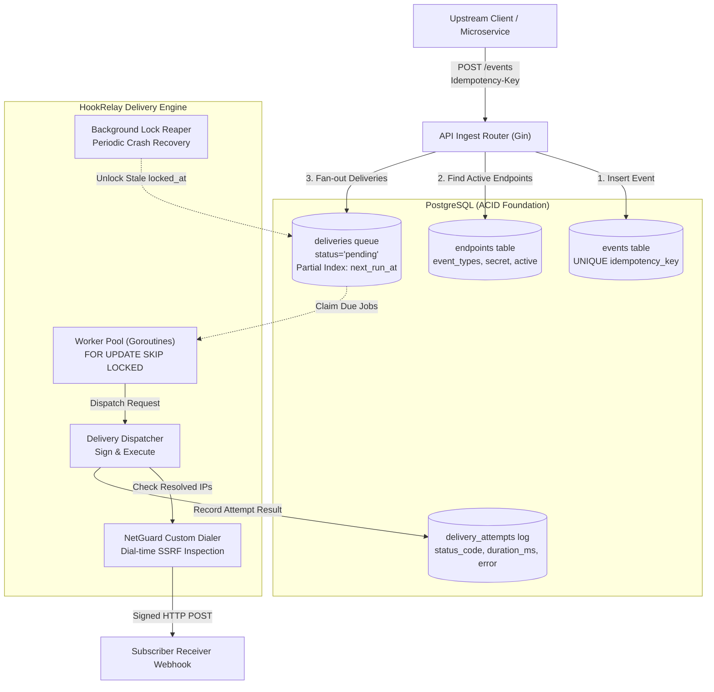

# HookRelay

> **A high-throughput, reliable webhook delivery engine written in Go, powered by PostgreSQL transactional queueing, HMAC-SHA256 signatures, connection-pooled HTTP dispatch, dial-time SSRF protection, and crash-resilient worker pools.**

---

## Table of Contents

- [Overview](#overview)
- [Architecture](#architecture)
- [Webhook Delivery Contract](#webhook-delivery-contract)
  - [HTTP Headers Specification](#http-headers-specification)
  - [Signature Calculation](#signature-calculation)
  - [Payload Format](#payload-format)
  - [Receiver Verification Examples](#receiver-verification-examples)
    - [Go Verification Example](#go-verification-example)
    - [Python Verification Example](#python-verification-example)
- [REST API Reference](#rest-api-reference)
  - [Endpoints API](#endpoints-api)
  - [Events Ingest API](#events-ingest-api)
  - [Deliveries & Replay API](#deliveries--replay-api)
- [Defensive Security & Resilience](#defensive-security--resilience)
  - [Dial-Time SSRF NetGuard](#dial-time-ssrf-netguard)
  - [Crash Recovery Lock Reaper](#crash-recovery-lock-reaper)
  - [Automatic Endpoint Circuit Breaker](#automatic-endpoint-circuit-breaker)
  - [Exponential Backoff with Full Jitter](#exponential-backoff-with-full-jitter)
- [Getting Started](#getting-started)
  - [Prerequisites](#prerequisites)
  - [Environment Variables](#environment-variables)
  - [Running with Docker Compose](#running-with-docker-compose)
  - [Running the Built-in Test Receiver](#running-the-built-in-test-receiver)
  - [Running the Test Suite](#running-the-test-suite)

---

## Overview

HookRelay solves the fundamental challenge of delivering webhook notifications to third-party endpoints reliably and securely:
- **Transactional Fan-Out:** Ingests events and fans out delivery tasks to all matching endpoints inside an atomic PostgreSQL ACID transaction.
- **Idempotency on Both Sides:** Ingest deduplication via client-supplied `Idempotency-Key` headers, and receiver deduplication via stable `X-HookRelay-Event-Id` headers across retries.
- **Cryptographic Delivery Contract:** Every outgoing webhook is signed with an HMAC-SHA256 signature calculated over the Unix timestamp and raw request body, protecting receivers against tampering and replay attacks.
- **Production HTTP Client:** Tuned transport connection pooling, strict dial/TLS/read timeouts, capped 1 KB response capture to prevent memory exhaustion, and redirect suppression (`http.ErrUseLastResponse`).
- **Defensive SSRF NetGuard:** Connect-time IP inspection preventing Server-Side Request Forgery against loopback (`127.0.0.1`), private RFC 1918 subnets, and cloud metadata (`169.254.169.254`), fully immune to DNS rebinding (TOCTOU) attacks.
- **Crash Recovery & Dead-Letter Replay:** Lock reaping for tasks abandoned during ungraceful worker crashes (`SIGKILL`, OOM) and a RESTful replay API for dead-letter recovery.

---

## Architecture



---

## Webhook Delivery Contract

HookRelay guarantees an exact, unambiguous delivery contract that subscriber applications can rely on to authenticate incoming events and prevent duplicate processing.

### HTTP Headers Specification

Every outgoing webhook delivery is dispatched as an `HTTP POST` containing the following standard headers:

| Header Name | Type | Description |
|---|---|---|
| `Content-Type` | `string` | Always `application/json; charset=utf-8`. |
| `X-HookRelay-Event-Id` | `string` | Globally unique, time-sortable event identifier (`evt_<timestamp><seq><rand>`). **Remains identical across all retry attempts** for a given event, allowing receivers to safely deduplicate deliveries. |
| `X-HookRelay-Delivery-Id` | `string` | Unique numeric identifier of this specific endpoint delivery task. |
| `X-HookRelay-Attempt` | `integer` | The attempt number for this delivery, starting at `1` and incrementing on each retry. |
| `X-HookRelay-Timestamp` | `integer` | Unix epoch timestamp (seconds) when the request was signed by HookRelay. |
| `X-HookRelay-Signature` | `string` | HMAC-SHA256 signature in `sha256=<64-char-hex>` format. |

### Signature Calculation

The signature header is computed using the endpoint's shared secret (`whsec_...`):

$$\text{signature} = \text{"sha256="} + \text{HMAC-SHA256}(\text{secret}, \text{timestamp} + \text{"."} + \text{raw\_body})$$

> [!IMPORTANT]
> Receivers **must** verify the signature against the **raw, unparsed request body bytes**. Re-serializing parsed JSON can alter whitespace, key ordering, or number formatting, causing verification to fail.

### Payload Format

The HTTP request body is a JSON object containing the event metadata and user data:

```json
{
  "id": "evt_01a1b0eb26d400108d97bfa9",
  "type": "order.completed",
  "created_at": "2026-11-06T15:00:00Z",
  "data": {
    "order_id": "ord_88412",
    "customer_id": "cust_9921",
    "amount_cents": 4900,
    "currency": "USD"
  }
}
```

### Receiver Verification Examples

#### Go Verification Example

```go
package main

import (
	"crypto/hmac"
	"crypto/sha256"
	"encoding/hex"
	"errors"
	"io"
	"net/http"
	"strconv"
	"strings"
	"time"
)

const EndpointSecret = "whsec_your_endpoint_secret_here"
const ToleranceWindow = 5 * time.Minute

func WebhookHandler(w http.ResponseWriter, r *http.Request) {
	if r.Method != http.MethodPost {
		http.Error(w, "Method Not Allowed", http.StatusMethodNotAllowed)
		return
	}

	// 1. Read raw body (do NOT deserialize JSON before verifying)
	rawBody, err := io.ReadAll(r.Body)
	if err != nil {
		http.Error(w, "Cannot read body", http.StatusBadRequest)
		return
	}

	// 2. Extract headers
	timestampHeader := r.Header.Get("X-HookRelay-Timestamp")
	signatureHeader := r.Header.Get("X-HookRelay-Signature")
	eventID := r.Header.Get("X-HookRelay-Event-Id")

	// 3. Prevent replay attacks: verify timestamp is within tolerance window
	tsSec, err := strconv.ParseInt(timestampHeader, 10, 64)
	if err != nil || time.Since(time.Unix(tsSec, 0)).Abs() > ToleranceWindow {
		http.Error(w, "Expired or invalid timestamp", http.StatusUnauthorized)
		return
	}

	// 4. Validate signature format
	if !strings.HasPrefix(signatureHeader, "sha256=") {
		http.Error(w, "Invalid signature format", http.StatusUnauthorized)
		return
	}
	expectedHex := strings.TrimPrefix(signatureHeader, "sha256=")

	// 5. Compute HMAC-SHA256 of (timestamp + "." + rawBody)
	mac := hmac.New(sha256.New, []byte(EndpointSecret))
	mac.Write([]byte(timestampHeader))
	mac.Write([]byte("."))
	mac.Write(rawBody)
	computedMAC := mac.Sum(nil)
	expectedMAC, err := hex.DecodeString(expectedHex)

	// 6. Constant-time comparison (prevents timing attacks)
	if err != nil || !hmac.Equal(computedMAC, expectedMAC) {
		http.Error(w, "Invalid signature", http.StatusUnauthorized)
		return
	}

	// 7. Check idempotency: ensure eventID has not already been processed
	// if isAlreadyProcessed(eventID) { w.WriteHeader(http.StatusOK); return }

	// Process payload...
	w.WriteHeader(http.StatusOK)
	w.Write([]byte(`{"status":"success"}`))
}
```

#### Python Verification Example

```python
import hmac
import hashlib
import time
from flask import Flask, request, jsonify, abort

app = Flask(__name__)
ENDPOINT_SECRET = b"whsec_your_endpoint_secret_here"
TOLERANCE_SECONDS = 300  # 5 minutes

@app.route("/webhook", methods=["POST"])
def webhook():
    # 1. Read raw body bytes
    raw_body = request.get_data()

    # 2. Extract headers
    timestamp_header = request.headers.get("X-HookRelay-Timestamp")
    signature_header = request.headers.get("X-HookRelay-Signature")
    event_id = request.headers.get("X-HookRelay-Event-Id")

    if not timestamp_header or not signature_header:
        abort(401, "Missing signature or timestamp headers")

    # 3. Prevent replay attacks
    try:
        timestamp = int(timestamp_header)
        if abs(time.time() - timestamp) > TOLERANCE_SECONDS:
            abort(401, "Timestamp outside tolerance window")
    except ValueError:
        abort(401, "Invalid timestamp format")

    # 4. Verify signature prefix
    if not signature_header.startswith("sha256="):
        abort(401, "Invalid signature format")
    provided_hex = signature_header[7:]

    # 5. Compute expected HMAC
    signed_payload = f"{timestamp_header}.".encode("utf-8") + raw_body
    computed_mac = hmac.new(ENDPOINT_SECRET, signed_payload, hashlib.sha256).hexdigest()

    # 6. Constant-time comparison (prevents timing side-channel attacks)
    if not hmac.compare_digest(computed_mac, provided_hex):
        abort(401, "Signature verification failed")

    # 7. Deduplicate using event_id and process business logic...
    return jsonify({"status": "received"}), 200

if __name__ == "__main__":
    app.run(port=8080)
```

---

## REST API Reference

### Endpoints API

#### `POST /endpoints`
Registers a new subscriber endpoint. The secret is returned **only once** in this response and stored securely in PostgreSQL.

**Request:**
```bash
curl -X POST http://localhost:8080/endpoints \
  -H "Content-Type: application/json" \
  -d '{
    "url": "https://api.subscriber.com/webhook",
    "event_types": ["order.created", "order.refunded"]
  }'
```
*Pass `"event_types": []` to subscribe to all event types.*

**Response (`201 Created`):**
```json
{
  "id": 1,
  "url": "https://api.subscriber.com/webhook",
  "secret": "whsec_9c1c4f5a8e2b4d1a9385c490a0f443b7",
  "event_types": ["order.created", "order.refunded"],
  "active": true,
  "created_at": "2026-11-06T15:10:00Z"
}
```

#### `GET /endpoints`
Lists all registered endpoints. Secret is masked for security.

#### `PATCH /endpoints/:id`
Updates endpoint URL, active status, or subscribed event types.

#### `DELETE /endpoints/:id`
Deletes an endpoint and cascades deletion to associated deliveries.

#### `POST /endpoints/:id/rotate-secret`
Rotates the endpoint's cryptographic signing secret and returns the new secret.

---

### Events Ingest API

#### `POST /events`
Publishes an event and fans out deliveries to all matching active endpoints in an ACID transaction. Supports client idempotency.

**Request:**
```bash
curl -X POST http://localhost:8080/events \
  -H "Content-Type: application/json" \
  -H "Idempotency-Key: idem_pay_994821" \
  -d '{
    "type": "order.created",
    "data": {
      "order_id": "ord_101",
      "amount": 2500
    }
  }'
```

**Response (`202 Accepted`):**
```json
{
  "id": "evt_01a1b0eb26d400108d97bfa9",
  "type": "order.created",
  "deliveries_count": 3,
  "is_duplicate": false
}
```
*If a request arrives with an already-processed `Idempotency-Key`, HookRelay returns `is_duplicate: true` with the original event ID without fanning out duplicate deliveries.*

#### `GET /events/:id`
Retrieves event details along with the status of all associated deliveries.

---

### Deliveries & Replay API

#### `GET /deliveries/:id`
Retrieves delivery status, attempt counts, and the complete execution history from `delivery_attempts`.

#### `POST /deliveries/:id/replay`
Manually resets a dead or completed delivery back to `pending`, resets attempts to `0`, and queues it for immediate re-dispatch.

**Request:**
```bash
curl -X POST http://localhost:8080/deliveries/42/replay
```

**Response (`200 OK`):**
```json
{
  "id": 42,
  "event_id": "evt_01a1b0eb26d400108d97bfa9",
  "endpoint_id": 1,
  "status": "pending",
  "attempts": 0,
  "next_run_at": "2026-11-06T15:25:00Z"
}
```

---

## Defensive Security & Resilience

### Dial-Time SSRF NetGuard
HookRelay implements connection-time IP validation inside `net.Dialer.DialContext`. Instead of validating URLs at registration time (which is vulnerable to **DNS Rebinding / TOCTOU** attacks), NetGuard resolves the domain immediately prior to opening the TCP socket and validates every candidate IP:
- Blocks Loopback: `127.0.0.0/8`, `::1/128`
- Blocks RFC 1918 Private IPv4: `10.0.0.0/8`, `172.16.0.0/12`, `192.168.0.0/16`
- Blocks Cloud Metadata & Link-Local: `169.254.0.0/16` (`169.254.169.254`)
- Blocks IPv6 ULA & Link-Local: `fc00::/7`, `fe80::/10`
- Connections are made **directly to the validated IP address**, preventing DNS rebinding.

### Crash Recovery Lock Reaper
When workers claim delivery tasks, they set `locked_at = now()`. If an OS process crashes abruptly (`SIGKILL`, host kernel panic, OOM killer), in-flight deliveries would remain locked forever. The background **Reaper** scans every 30 seconds for deliveries where `locked_at` is older than 5 minutes and clears `locked_at = NULL`, allowing active workers to safely reclaim and resume delivery.

### Automatic Endpoint Circuit Breaker
If an endpoint accumulates 20 consecutive delivery failures across attempts, HookRelay sets `endpoints.active = false`. This circuit-breaker prevents misconfigured or decommissioned subscriber servers from overwhelming the queue and consuming worker bandwidth.

### Exponential Backoff with Full Jitter
Transient failures (network errors, timeouts, HTTP `5xx`, `408`, `429`) are retried with exponential backoff and randomized jitter to prevent the "thundering herd" problem:

$$\text{delay} = \min\left(\text{MaxInterval}, \text{InitialInterval} \times 2^{\text{attempt}-1}\right) + \text{jitter}$$

Permanent client rejections (HTTP `400`, `401`, `403`, `404`, `410`, `422`) transition immediately to `dead` without retrying.

---

## Getting Started

### Prerequisites
- [Go 1.22+](https://go.dev/dl/)
- [Docker & Docker Compose](https://www.docker.com/)
- [PostgreSQL 15+](https://www.postgresql.org/) (if running outside Docker)

### Environment Variables

| Variable | Default | Description |
|---|---|---|
| `PORT` | `8080` | Port for the HTTP API server. |
| `DATABASE_URL` | `postgres://postgres@localhost:5432/hookrelay?sslmode=disable` | PostgreSQL connection string. |
| `HOOKRELAY_ALLOW_LOCAL` | `true` | When `false`, NetGuard blocks loopback and private IPs (set to `false` in production). |

### Running with Docker Compose (PostgreSQL, Prometheus & Grafana)

Start the full infrastructure stack:
```bash
docker compose up -d
```
This boots up:
- **PostgreSQL** on `localhost:5432`
- **Prometheus** on `localhost:9090` (configured to scrape HookRelay metrics)
- **Grafana** on `localhost:3000` (pre-provisioned with the HookRelay Overview Dashboard)

Run HookRelay:
```bash
go run ./cmd/hookrelay
```

Access the dashboards:
- **HookRelay API & Metrics:** `http://localhost:8080/metrics`
- **Prometheus Scraper UI:** `http://localhost:9090`
- **Grafana Live Dashboard:** `http://localhost:3000` *(Login: `admin` / `admin`)*

---

## Telemetry & Observability (Prometheus & Grafana)

HookRelay natively exposes real-time Prometheus metrics at `GET /metrics` for deep operational visibility:

| Metric Name | Type | Description |
|---|---|---|
| `hookrelay_events_ingested_total` | Counter | Total events received via `POST /events` (labeled by `type`, `duplicate`). |
| `hookrelay_deliveries_created_total` | Counter | Total deliveries fanned out across subscriber endpoints (labeled by `event_type`). |
| `hookrelay_deliveries_attempts_total` | Counter | Outbound attempts labeled by `status` (`success`, `retry`, `dead`) and `status_code`. |
| `hookrelay_deliveries_duration_seconds` | Histogram | Latency distribution of outbound HTTP requests (p50, p90, p99). |
| `hookrelay_reaper_recovered_deliveries_total` | Counter | Stuck deliveries reclaimed by the crash recovery reaper. |
| `hookrelay_endpoints_deactivated_total` | Counter | Endpoints auto-disabled by consecutive failure circuit breakers. |
| `hookrelay_queue_pending_deliveries` | Gauge | Current count of pending deliveries in PostgreSQL. |
| `hookrelay_queue_due_deliveries` | Gauge | Deliveries due for execution right now (`next_run_at <= now`). |
| `hookrelay_endpoints_active_count` | Gauge | Count of active endpoints currently accepting deliveries. |

The included Grafana dashboard (`deploy/grafana/dashboards/hookrelay.json`) visualizes queue backlog depth, worker throughput, latency percentiles, error rates, and endpoint circuit breaker events out of the box.

### Running the Built-in Test Receiver

HookRelay includes a standalone test receiver with configurable modes (`ok`, `fail`, `slow`, `flaky`) and HMAC signature verification:

```bash
# Run test receiver on port 8081 in flaky mode (50% failure)
go run ./cmd/testreceiver -port=8081 -mode=flaky -secret=whsec_your_secret
```

Supported test modes:
- `ok`: Always returns `200 OK`.
- `fail`: Always returns `500 Internal Server Error`.
- `slow`: Sleeps 10 seconds before responding (verifies client timeout handling).
- `flaky`: Fails alternately with `500` and succeeds with `200` (verifies retry backoff).

### Running the Test Suite

Run unit and integration tests:
```bash
go test -v ./...
```

Run the entire test suite with the **Go race detector**:
```bash
go test -race -p 1 ./...
```

Run end-to-end concurrent integration tests:
```bash
go test -v ./test
```
