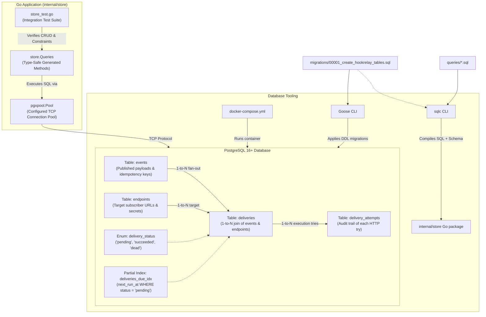
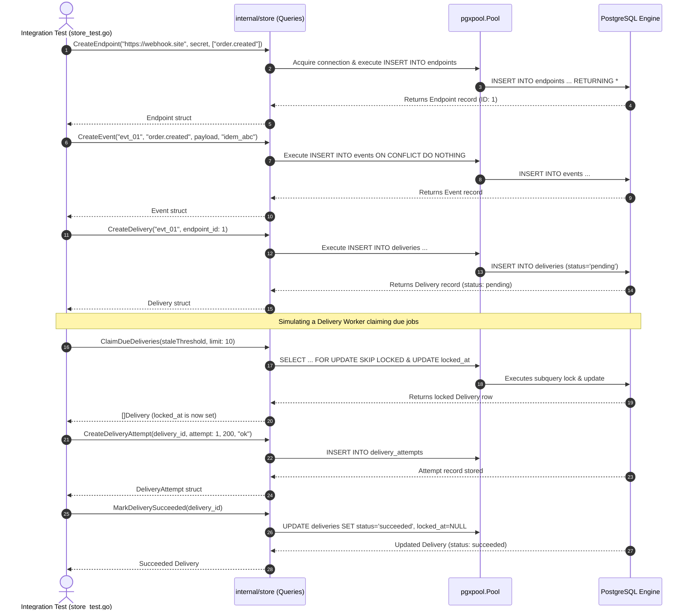

# Phase 1: Database Foundation — Learning Guide

Welcome to the learning companion for **Phase 1: Database Foundation** of HookRelay.

This document details every design decision, file, database concept, and architectural pattern implemented in this phase. The goal of this guide is to explain **why** things were built this way, not just show the code.

---

## 1. System Architecture & Flow

In Phase 1, our primary objective is to build a reliable, type-safe persistence layer for HookRelay. HookRelay is a webhook delivery engine: it accepts events from publishers and reliably delivers them to third-party subscriber URLs over HTTP, recording every attempt and retrying failures.

Before implementing any HTTP API or delivery worker pool, we must establish:
1. **Durable storage** in a relational database (PostgreSQL) that maintains absolute data integrity.
2. **Strict lifecycle guarantees** using database constraints (such as `UNIQUE (event_id, endpoint_id)` and `ON CONFLICT DO NOTHING`).
3. **Type-safe database interactions** using `sqlc` and `pgx/v5`, eliminating runtime string formatting bugs and connection leaks.

### Architecture Diagram



### Data Flow in Phase 1

1. **Migration Time**: `goose` runs `migrations/00001_create_hookrelay_tables.sql` against PostgreSQL. The `delivery_status` enum, relational tables, constraints, foreign keys with cascading deletes, and partial index `deliveries_due_idx` are created.
2. **Code Generation Time**: `sqlc` parses the migration DDL and the queries in `queries/`, verifying that column names and types match. It generates Go models (`internal/store/models.go`) and query wrappers (`internal/store/*.sql.go`).
3. **Runtime**: The Go application calls `store.NewPool()` to open and validate a connection pool (`*pgxpool.Pool`). The application instantiates `store.New(pool)` to execute queries safely.
4. **Test Verification**: The test suite (`store_test.go`) exercises endpoint CRUD, event idempotency deduplication, delivery claiming (`FOR UPDATE SKIP LOCKED`), and attempt logging against real PostgreSQL.

---

## 2. File-by-File Breakdown

### `docker-compose.yml`
- **Location:** Project root (`./docker-compose.yml`)
- **Purpose:** Declares the local containerized PostgreSQL 16 service for development and testing.
- **What it does:** Ensures every developer and test environment runs the exact same version of PostgreSQL with consistent credentials, health checks, and persistent volumes.
- **Important components:**
  - `image: postgres:16-alpine`: A lightweight, production-grade PostgreSQL image.
  - `POSTGRES_DB: hookrelay`: Pre-creates the `hookrelay` database upon container startup.
  - `healthcheck`: Uses `pg_isready -U postgres -d hookrelay` to verify PostgreSQL is accepting connections before dependent services start.
- **Why this approach:** Containerizing Postgres prevents "works on my machine" issues and avoids requiring manual local database installations.

```yaml
services:
  postgres:
    image: postgres:16-alpine
    container_name: hookrelay-postgres
    restart: unless-stopped
    environment:
      POSTGRES_USER: postgres
      POSTGRES_PASSWORD: postgres
      POSTGRES_DB: hookrelay
    ports:
      - "5432:5432"
    volumes:
      - postgres_data:/var/lib/postgresql/data
    healthcheck:
      test: ["CMD-SHELL", "pg_isready -U postgres -d hookrelay"]
      interval: 5s
      timeout: 5s
      retries: 5

volumes:
  postgres_data:
```

---

### `migrations/00001_create_hookrelay_tables.sql`
- **Location:** `migrations/00001_create_hookrelay_tables.sql`
- **Purpose:** Defines the foundational relational schema and database migration steps (Up and Down) using Goose.
- **What it does:** Creates the four core tables (`endpoints`, `events`, `deliveries`, `delivery_attempts`), the `delivery_status` enum, and the partial index `deliveries_due_idx`.
- **Important components:**
  - `-- +goose Up` / `-- +goose Down`: Goose migration boundaries.
  - `CREATE TYPE delivery_status AS ENUM ('pending', 'succeeded', 'dead')`: Enforces valid delivery state transitions at the database layer.
  - `UNIQUE (event_id, endpoint_id)`: Guarantees that even if fan-out logic is triggered multiple times concurrently, duplicate delivery tasks cannot be inserted.
  - `CREATE INDEX deliveries_due_idx ON deliveries (next_run_at) WHERE status = 'pending'`: A partial index specifically optimized for background worker claiming.
- **Why this approach:** Migrations track database evolution in version control. Plain SQL migrations are transparent, engine-native, and run predictably without ORM magic.

```sql
CREATE TYPE delivery_status AS ENUM ('pending', 'succeeded', 'dead');

CREATE TABLE deliveries (
    id          BIGSERIAL PRIMARY KEY,
    event_id    TEXT            NOT NULL REFERENCES events(id) ON DELETE CASCADE,
    endpoint_id BIGINT          NOT NULL REFERENCES endpoints(id) ON DELETE CASCADE,
    status      delivery_status NOT NULL DEFAULT 'pending',
    attempts    INT             NOT NULL DEFAULT 0,
    next_run_at TIMESTAMPTZ     NOT NULL DEFAULT now(),
    locked_at   TIMESTAMPTZ,
    created_at  TIMESTAMPTZ     NOT NULL DEFAULT now(),
    UNIQUE (event_id, endpoint_id)
);

CREATE INDEX deliveries_due_idx ON deliveries (next_run_at) WHERE status = 'pending';
```

---

### `sqlc.yaml`
- **Location:** Project root (`./sqlc.yaml`)
- **Purpose:** Configuration file for the `sqlc` code generator.
- **What it does:** Directs `sqlc` to parse the migration DDL in `migrations/` and the query files in `queries/`, generating idiomatic Go code in `internal/store` using `pgx/v5`.
- **Important components:**
  - `engine: "postgresql"`: Specifies PostgreSQL dialect.
  - `package: "store"`: The Go package name for generated code.
  - `out: "internal/store"`: Target directory for generated Go files.
  - `sql_package: "pgx/v5"`: Directs `sqlc` to generate code for `jackc/pgx/v5`, which avoids generic `database/sql` reflection overhead and natively supports Postgres arrays and JSONB.
- **Why this approach:** `sqlc` generates type-safe Go code directly from raw SQL queries at compile time. If a column name is misspelled or types mismatch, `sqlc generate` fails immediately rather than failing at runtime in production.

---

### `queries/endpoints.sql`
- **Location:** `queries/endpoints.sql`
- **Purpose:** SQL queries for endpoint registration, secret rotation, updates, and fan-out matching.
- **Important queries:**
  - `CreateEndpoint`: Inserts an endpoint with target URL, secret, and subscribed event types.
  - `RotateEndpointSecret`: Updates an endpoint's HMAC signing secret.
  - `ListActiveEndpointsForEventType`: Finds active endpoints whose `event_types` array contains the event type or is empty (meaning subscribed to all events):
    ```sql
    -- name: ListActiveEndpointsForEventType :many
    SELECT * FROM endpoints
    WHERE active = true
      AND (cardinality(event_types) = 0 OR sqlc.arg('event_type')::text = ANY(event_types))
    ORDER BY id ASC;
    ```
- **Why this approach:** Using `cardinality(event_types) = 0` provides an elegant convention where empty array subscribers receive all events (wildcard behavior) without needing complex join tables.

---

### `queries/events.sql`
- **Location:** `queries/events.sql`
- **Purpose:** SQL queries for event ingestion and deduplication.
- **Important queries:**
  - `CreateEvent`: Inserts published events using an optional client-supplied idempotency key.
    ```sql
    -- name: CreateEvent :one
    INSERT INTO events (id, type, payload, idempotency_key)
    VALUES ($1, $2, $3, $4)
    ON CONFLICT (idempotency_key) DO NOTHING
    RETURNING *;
    ```
  - `GetEventByIdempotencyKey`: Retrieves the existing event when a duplicate ingest request arrives.
- **Why this approach:** `ON CONFLICT (idempotency_key) DO NOTHING` pushes deduplication to the database index, guaranteeing atomicity even if two identical requests hit the server in parallel.

---

### `queries/deliveries.sql`
- **Location:** `queries/deliveries.sql`
- **Purpose:** Queries for delivery creation, worker claiming (`FOR UPDATE SKIP LOCKED`), retry scheduling, and replay.
- **Important queries:**
  - `ClaimDueDeliveries`: Atomically claims due pending deliveries using row-level locking while skipping locked rows so parallel workers never block each other:
    ```sql
    -- name: ClaimDueDeliveries :many
    UPDATE deliveries
    SET locked_at = now()
    WHERE id IN (
        SELECT d.id
        FROM deliveries d
        WHERE d.status = 'pending'
          AND d.next_run_at <= now()
          AND (d.locked_at IS NULL OR d.locked_at < $1)
        ORDER BY d.next_run_at ASC
        LIMIT $2
        FOR UPDATE SKIP LOCKED
    )
    RETURNING *;
    ```
  - `ScheduleDeliveryRetry`: Updates `next_run_at` with backoff time and increments attempt count.
  - `ReplayDelivery`: Resets a `dead` delivery back to `pending` with `attempts = 0` and `next_run_at = now()`.

---

### `queries/delivery_attempts.sql`
- **Location:** `queries/delivery_attempts.sql`
- **Purpose:** Stores the immutable audit record of each HTTP attempt.
- **Important queries:**
  - `CreateDeliveryAttempt`: Inserts timestamp, HTTP status code, duration in milliseconds, error message (if any), and truncated response body.
  - `ListAttemptsByDeliveryID`: Returns all historical attempts for a delivery ordered by attempt number.
- **Why this approach:** Separating the mutable delivery task (`deliveries`) from the immutable execution log (`delivery_attempts`) keeps the queue table compact while preserving full audit history.

---

### `internal/store/pool.go`
- **Location:** `internal/store/pool.go`
- **Purpose:** Establishes and manages a production-grade PostgreSQL connection pool using `pgxpool`.
- **What it does:** Parses the database connection string, configures pool size and connection lifecycles, and verifies database availability via `Ping` before returning.
- **Important components:**
  - `PoolConfig`: Configuration struct holding `DatabaseURL`, `MaxConns`, `MinConns`, `MaxConnIdleTime`, and `MaxConnLifetime`.
  - `NewPool(ctx, cfg)`: Factory function setting sensible production defaults:
    - Default `MaxConns`: 10
    - Default `MinConns`: 2
    - Default `MaxConnIdleTime`: 5 minutes
    - Default `MaxConnLifetime`: 1 hour
  - `pool.Ping(pingCtx)`: Immediate connectivity check with a 3-second timeout.
- **Why this approach:** Opening a new TCP and TLS connection for every query introduces heavy latency. A pre-warmed connection pool reuses open sockets and shields Postgres from connection spikes.

```go
func NewPool(ctx context.Context, cfg PoolConfig) (*pgxpool.Pool, error) {
	pgxCfg, err := pgxpool.ParseConfig(cfg.DatabaseURL)
	if err != nil {
		return nil, fmt.Errorf("failed to parse database URL: %w", err)
	}

	pgxCfg.MaxConns = 10
	if cfg.MaxConns > 0 {
		pgxCfg.MaxConns = cfg.MaxConns
	}
	// ... (idle & lifetime configs)

	pool, err := pgxpool.NewWithConfig(ctx, pgxCfg)
	if err != nil {
		return nil, fmt.Errorf("failed to create connection pool: %w", err)
	}

	pingCtx, cancel := context.WithTimeout(ctx, 3*time.Second)
	defer cancel()
	if err := pool.Ping(pingCtx); err != nil {
		pool.Close()
		return nil, fmt.Errorf("failed to ping database: %w", err)
	}
	return pool, nil
}
```

---

### `internal/store/store_test.go`
- **Location:** `internal/store/store_test.go`
- **Purpose:** Integration test suite validating the database schema, constraints, queries, and connection pool against a real PostgreSQL instance.
- **What it tests:**
  - `TestStore_EndpointCRUD`: Validates endpoint insertion, retrieval, update, secret rotation, filtering by event type, and deletion.
  - `TestStore_EventIdempotency`: Confirms that inserting duplicate events with the same `idempotency_key` is safely handled by `ON CONFLICT DO NOTHING`.
  - `TestStore_DeliveriesAndAttempts`: Verifies delivery creation, `(event_id, endpoint_id)` uniqueness, claiming due deliveries with `FOR UPDATE SKIP LOCKED`, attempt logging, status updates to `succeeded`, and replaying dead deliveries.
- **Why this approach:** Database queries and constraints cannot be faithfully verified with in-memory mocks. Running integration tests against real PostgreSQL guarantees the SQL and index definitions actually work as expected.

---

### `Makefile`
- **Location:** Project root (`./Makefile`)
- **Purpose:** Standard developer command runner for local build, test, and migration operations.
- **Key targets:**
  - `make up`: Starts Docker services.
  - `make migrate`: Applies Goose migrations.
  - `make migrate-down`: Rolls back the last migration.
  - `make sqlc`: Re-generates Go store code from SQL files.
  - `make test`: Runs integration tests.
  - `make vet`: Runs Go static analysis.

---

## 3. Core Backend Concepts Explained

### 1. PostgreSQL Schema Design for Queues & Webhooks
In a webhook delivery engine, data falls into three categories:
- **Configurations:** `endpoints` (infrequent writes, frequent reads).
- **Incoming Events:** `events` (append-only, high-write).
- **Queue State & History:** `deliveries` (mutable task state: `pending`, `next_run_at`, `locked_at`) and `delivery_attempts` (immutable append-only audit trail).

Separating mutable delivery tasks from immutable attempt logs is a critical pattern. If attempts were stored as an array inside `deliveries`, updating the row on every HTTP try would trigger PostgreSQL tuple updates (MVCC dead tuples) on a wide row. By keeping `deliveries` lean and inserting separate lightweight `delivery_attempts` rows, the queue table remains fast and cache-friendly.

### 2. Database Migrations and Why They Matter
A schema change is code. Storing DDL scripts in version control (`migrations/00001_create_hookrelay_tables.sql`) ensures:
- **Reproducibility:** Any developer or CI/CD pipeline can reconstruct the exact database schema from scratch.
- **Evolution Tracking:** Teams can see who changed which table, when, and why.
- **Rollback Safety:** Goose supports forward (`Up`) and rollback (`Down`) paths, allowing safe rollbacks if a deployment needs to be reverted.

### 3. PostgreSQL ENUMs
The `delivery_status` column uses a custom PostgreSQL enum type:
```sql
CREATE TYPE delivery_status AS ENUM ('pending', 'succeeded', 'dead');
```
- **Type Safety:** The database will reject invalid values (e.g., `'in-progress'` or typo `'pendng'`) immediately.
- **Storage Efficiency:** Internally, PostgreSQL stores ENUM values as 4-byte internal integers rather than full text strings, saving disk space and index memory.

### 4. Partial Indexes in Job Queues
In high-throughput webhook systems, 99% of deliveries will be in the `succeeded` state after a few seconds. If we created a standard B-tree index on `next_run_at`:
```sql
-- Standard index (BAD for large queues):
CREATE INDEX deliveries_due_idx ON deliveries (next_run_at);
```
As millions of delivered events accumulate, the index grows huge. Every worker query has to traverse a massive tree where 99.9% of rows are irrelevant (`succeeded`).

Instead, we use a **partial index**:
```sql
-- Partial index (OPTIMAL):
CREATE INDEX deliveries_due_idx ON deliveries (next_run_at) WHERE status = 'pending';
```
PostgreSQL only indexes rows where `status = 'pending'`. The moment a delivery transitions to `succeeded` or `dead`, PostgreSQL automatically removes it from the index. The index stays tiny, fits entirely in RAM, and scans in microseconds.

### 5. `sqlc` vs ORMs (Like GORM or Hibernate)
Many frameworks use Object-Relational Mappers (ORMs). While convenient, ORMs often introduce:
- N+1 query problems.
- Heavy reflection overhead.
- Unpredictable generated SQL that is difficult to optimize.

`sqlc` takes the opposite approach: **you write raw, performant SQL**, and `sqlc` parses your queries against the PostgreSQL schema to compile standard, type-safe Go structs and functions. You get the maximum performance of hand-crafted SQL with the compile-time safety of a strongly typed language.

### 6. `pgx` and Connection Pooling (`pgxpool`)
Connecting to a database requires establishing a TCP socket, negotiating TLS, authenticating credentials, and allocating backend memory inside PostgreSQL. Doing this per HTTP request would cripple performance.

`pgxpool.Pool` maintains a pool of warm connections:
- `MaxConns` limits the maximum simultaneous database connections, protecting PostgreSQL from connection exhaustion under high traffic spikes.
- `MinConns` keeps a baseline number of connections ready to eliminate connection handshake latency.
- `MaxConnIdleTime` closes unused connections to release database memory during quiet periods.
- `MaxConnLifetime` periodically recycles connections to prevent memory fragmentation and balance connections across PostgreSQL server backends.

### 7. Ingest Idempotency & Database Deduplication
Clients retrying `POST /events` due to transient network timeouts could easily submit duplicate events. HookRelay enforces ingest deduplication at the database level:
```sql
INSERT INTO events (id, type, payload, idempotency_key)
VALUES ($1, $2, $3, $4)
ON CONFLICT (idempotency_key) DO NOTHING
RETURNING *;
```
If two identical requests arrive simultaneously on different application servers, both attempt the insert. PostgreSQL's unique index atomically allows the first one and turns the second one into a no-op without creating duplicates. The application can then fetch and return the original event.

---

## 4. How Everything Connects (Execution Flow)

Here is how data flows through the Phase 1 components during an end-to-end integration test:



---

## 5. Learning Checklist & Self-Assessment

### Key Takeaways
- The foundation of an asynchronous delivery engine is a rock-solid database schema with strict integrity constraints.
- Partial indexes allow queue tables to remain fast even when millions of completed jobs exist.
- Database unique constraints (`ON CONFLICT`) are the only truly atomic defense against duplicate work in distributed systems.
- Connection pooling balances application throughput while safeguarding database resources.
- `sqlc` combines the performance and clarity of hand-written SQL with compile-time type safety.

### Important Terminology
- **DDL (Data Definition Language):** SQL statements (`CREATE`, `ALTER`, `DROP`) that define the database structure.
- **Partial Index:** A database index built only over a subset of rows that satisfy a `WHERE` condition.
- **Idempotency Key:** A client-provided unique identifier that guarantees repeated identical requests produce the same effect as a single request.
- **FOR UPDATE SKIP LOCKED:** A PostgreSQL locking feature that allows multiple workers to claim available rows concurrently without waiting on or deadlocking with each other.
- **Fan-Out:** The architectural pattern where a single event produces multiple independent delivery tasks for multiple subscribers.
- **Connection Pool:** A cache of persistent database connections maintained so that requests can reuse existing connections rather than opening a new one every time.

### Questions You Should Be Able to Answer
1. Why is `UNIQUE (event_id, endpoint_id)` on the `deliveries` table essential even though the application's fan-out logic is wrapped in a transaction?
2. What happens to a standard B-tree index on `next_run_at` after 10 million webhooks have been successfully delivered, and why does a partial index solve this problem?
3. Why does `CreateEvent` use `ON CONFLICT (idempotency_key) DO NOTHING` instead of performing a `SELECT` check first in Go code?
4. Why do we store `delivery_attempts` as separate rows rather than updating columns or appending JSON into the `deliveries` table?
5. What are the risks of using unbounded connection pools, and how do `MaxConns` and `MaxConnLifetime` protect the system?

### Areas to Investigate Further
- **PostgreSQL JSONB Indexing:** Explore GIN indexes if you ever need to query or filter inside event payloads (`payload ->> 'customer_id'`).
- **Table Partitioning:** For systems delivering hundreds of millions of webhooks per month, explore PostgreSQL declarative table partitioning by month on `delivery_attempts`.
- **Advisory Locks vs Row Locks:** Research how PostgreSQL advisory locks can be used for distributed locking when row-level locks are not suitable.
