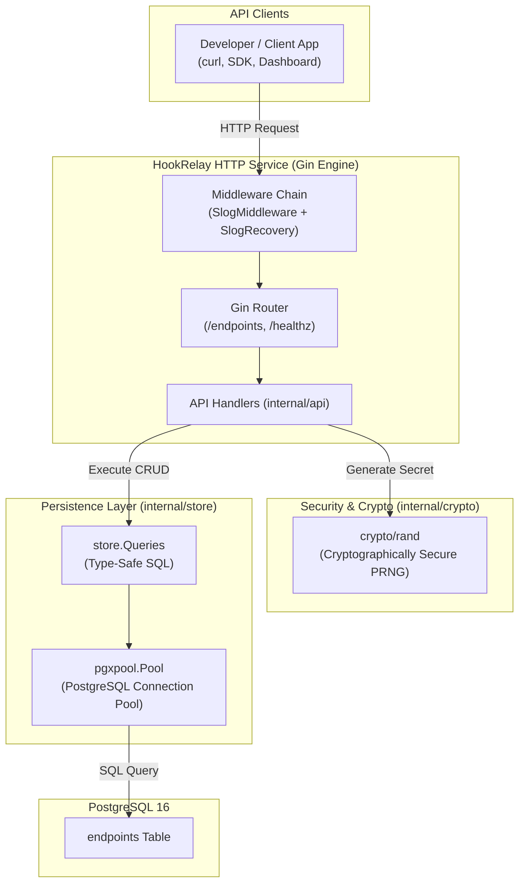
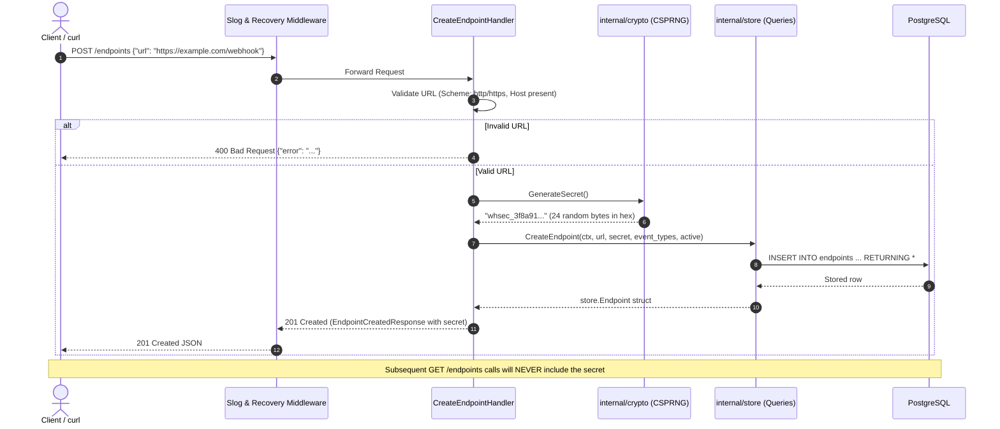

# Phase 2: REST API & Credential Lifecycle — Learning Guide

Welcome to the learning companion for **Phase 2: REST API & Credential Lifecycle** of HookRelay.

In Phase 1, we built the durable database layer, migrations, and type-safe query engine using `sqlc` and `pgx/v5`. In Phase 2, we expose this database through a production-ready HTTP REST API built with Gin, implement cryptographically secure secret generation, enforce strict write-only credential privacy, and construct a robust server bootstrap with graceful shutdown.

---

## 1. System Architecture & Request Lifecycle

HookRelay manages subscriber webhook endpoints where external systems register to receive notifications. The API layer acts as the gatekeeper: it validates input, generates high-entropy signing secrets, prevents credential leaks, and translates HTTP operations into database queries.

### Architecture Diagram



### End-to-End Request Flow (Endpoint Registration)



---

## 2. File-by-File Breakdown

### `internal/config/config.go`
- **Location:** `internal/config/config.go`
- **Purpose:** Centralizes application runtime configuration loaded from environment variables.
- **What it does:** Reads configuration values (`PORT`, `DATABASE_URL`, `LOG_LEVEL`, `ENV`) with fallback defaults if unset.
- **Important components:**
  - `Config` struct: Strongly typed representation of system settings.
  - `Load()` function: Reads environment variables and populates defaults.
  - `getEnv(key, defaultVal)` helper: Safely extracts values from the environment.
- **Why this approach:** Hardcoding configuration is an anti-pattern (12-Factor App methodology). Centralizing configuration loading ensures that runtime parameters can be changed in Docker or Kubernetes without recompilation.

```go
type Config struct {
	Port        string
	DatabaseURL string
	LogLevel    string
	Env         string
}

func Load() *Config {
	return &Config{
		Port:        getEnv("PORT", "8080"),
		DatabaseURL: getEnv("DATABASE_URL", "postgres://postgres@localhost:5432/hookrelay?sslmode=disable"),
		LogLevel:    getEnv("LOG_LEVEL", "info"),
		Env:         getEnv("ENV", "development"),
	}
}
```

---

### `internal/crypto/secret.go`
- **Location:** `internal/crypto/secret.go`
- **Purpose:** Generates cryptographically secure secrets used for HMAC-SHA256 webhook signatures.
- **What it does:** Reads 24 bytes of high-entropy randomness from the operating system's CSPRNG (`crypto/rand`), hex-encodes them, and prefixes them with `whsec_`.
- **Important components:**
  - `SecretPrefix = "whsec_"`: Standard prefix following industry conventions (e.g., Stripe's `whsec_`).
  - `SecretRandomBytes = 24`: 192 bits of cryptographic entropy, preventing any possibility of brute-force prediction.
  - `GenerateSecret() (string, error)`: Factory function returning the token.
- **Why this approach:** Never use `math/rand` for cryptographic credentials. `math/rand` is a pseudo-random number generator that produces deterministic, mathematically predictable outputs. `crypto/rand` interfaces directly with operating system entropy pools (such as `/dev/urandom` or Windows `CryptGenRandom`).

```go
const (
	SecretPrefix      = "whsec_"
	SecretRandomBytes = 24
)

func GenerateSecret() (string, error) {
	b := make([]byte, SecretRandomBytes)
	if _, err := rand.Read(b); err != nil {
		return "", fmt.Errorf("failed to generate random secret bytes: %w", err)
	}
	return SecretPrefix + hex.EncodeToString(b), nil
}
```

---

### `internal/crypto/secret_test.go`
- **Location:** `internal/crypto/secret_test.go`
- **Purpose:** Unit tests verifying the format, length, prefix, and uniqueness of generated secrets across 100 consecutive generations.

---

### `internal/api/types.go`
- **Location:** `internal/api/types.go`
- **Purpose:** Defines the JSON request payloads, response envelopes, and data transfer objects (DTOs).
- **What it does:** Implements structural separation between public representations and database models.
- **Important components:**
  - `CreateEndpointRequest`: Requires `url` and optional `event_types`.
  - `UpdateEndpointRequest`: Pointer fields (`*string`, `*bool`) allow clients to perform partial updates (`PATCH`), updating only the fields provided.
  - `EndpointResponse`: The standard read model for endpoints. **Crucially, the `Secret` field is omitted entirely.**
  - `EndpointCreatedResponse`: Embeds `EndpointResponse` and adds `Secret string`. This struct is returned strictly once upon initial creation.
  - `RotateSecretResponse`: Returns `{ "id": 1, "secret": "whsec_..." }` once upon rotation.
- **Why this approach:** Having dedicated DTOs prevents accidental credential leaks. If we returned the raw `store.Endpoint` struct directly to clients, any future column added to the database would automatically leak into JSON responses.

```go
type EndpointResponse struct {
	ID         int64     `json:"id"`
	Url        string    `json:"url"`
	EventTypes []string  `json:"event_types"`
	Active     bool      `json:"active"`
	CreatedAt  time.Time `json:"created_at"`
}

// EndpointCreatedResponse includes the generated secret, returned strictly once upon creation.
type EndpointCreatedResponse struct {
	EndpointResponse
	Secret string `json:"secret"`
}
```

---

### `internal/api/middleware.go`
- **Location:** `internal/api/middleware.go`
- **Purpose:** Intercepts incoming HTTP requests to provide structured logging and panic recovery.
- **What it does:**
  - `SlogMiddleware`: Uses Go's standard `log/slog` to record execution latency, HTTP method, path, query parameters, client IP, and response status code. Automatically elevates log levels to `Warn` (4xx) and `Error` (5xx).
  - `SlogRecovery`: Catches unexpected panics in handlers, logs stack traces, and terminates the request cleanly with a `500 Internal Server Error` JSON response instead of crashing the process.
- **Why this approach:** Structured JSON logging enables log aggregators (e.g. Datadog, Grafana Loki) to parse and index request metrics without fragile regex parsing.

---

### `internal/api/handlers.go`
- **Location:** `internal/api/handlers.go`
- **Purpose:** Implements the business logic for each API endpoint.
- **Important functions:**
  - `isValidURL(rawURL string) bool`: Validates that URLs are absolute, parseable, have scheme `http` or `https`, and specify a valid host.
  - `CreateEndpointHandler`: Validates input, invokes `crypto.GenerateSecret()`, inserts via SQLC, and returns `201 Created` with the secret.
  - `ListEndpointsHandler`: Fetches all endpoints and maps them to `EndpointResponse` (omitting secret).
  - `GetEndpointByIDHandler`: Retrieves a single endpoint by ID, returning `404 Not Found` if missing.
  - `UpdateEndpointHandler`: Supports partial updates for URL, active flag, and subscribed event types.
  - `DeleteEndpointHandler`: Removes the endpoint and returns `204 No Content`.
  - `RotateSecretHandler`: Generates a fresh secret for an existing endpoint and returns it once.
- **Why this approach:** Handlers remain lean because data persistence is delegated to `store.Queries` and cryptographic work is delegated to `internal/crypto`.

```go
func isValidURL(rawURL string) bool {
	u, err := url.ParseRequestURI(rawURL)
	if err != nil {
		return false
	}
	if u.Scheme != "http" && u.Scheme != "https" {
		return false
	}
	if u.Host == "" {
		return false
	}
	return true
}
```

---

### `internal/api/server.go`
- **Location:** `internal/api/server.go`
- **Purpose:** Wires together the Gin router, middleware, routes, database queries, and logger.
- **What it does:**
  - Configures Gin in `ReleaseMode`.
  - Attaches `SlogMiddleware` and `SlogRecovery`.
  - Registers the route hierarchy:
    - `GET /healthz`
    - `POST /endpoints`
    - `GET /endpoints`
    - `GET /endpoints/:id`
    - `PATCH /endpoints/:id`
    - `DELETE /endpoints/:id`
    - `POST /endpoints/:id/rotate-secret`
- **Why this approach:** Providing a `NewServer(pool, logger) *Server` constructor with a `.Router()` accessor allows both the main binary and test suites to instantiate the identical router without duplicating route setup.

---

### `cmd/hookrelay/main.go`
- **Location:** `cmd/hookrelay/main.go`
- **Purpose:** The application entry point (binary main package).
- **What it does:**
  1. Loads configuration from `internal/config`.
  2. Configures structured JSON logging (`slog`).
  3. Establishes the PostgreSQL connection pool (`store.NewPool`).
  4. Instantiates the HTTP server (`api.NewServer`).
  5. Listens for OS interrupt signals (`SIGINT`, `SIGTERM`) using `signal.NotifyContext`.
  6. Initiates **graceful shutdown** with a 10-second timeout, allowing in-flight requests to complete before closing database connections.
- **Why this approach:** Abruptly killing an HTTP server aborts client requests mid-flight and causes connection reset errors. Graceful shutdown stops accepting new requests while giving existing requests a deadline to finish cleanly.

```go
// 1. Root context tied to OS termination signals (SIGINT, SIGTERM)
ctx, stop := signal.NotifyContext(context.Background(), os.Interrupt, syscall.SIGTERM)
defer stop()

// ... server startup ...

// Wait for termination signal
<-ctx.Done()
logger.Info("shutdown signal received, initiating graceful shutdown...")

shutdownCtx, cancelHTTP := context.WithTimeout(context.Background(), 10*time.Second)
defer cancelHTTP()
if err := httpServer.Shutdown(shutdownCtx); err != nil {
    logger.Error("HTTP server forced to shutdown", "error", err)
}
```

---

### `internal/api/api_test.go`
- **Location:** `internal/api/api_test.go`
- **Purpose:** End-to-end HTTP integration tests for the REST API using `net/http/httptest`.
- **What it tests:**
  - Health check endpoint returns `200 OK`.
  - Creating an endpoint returns `201 Created` with a valid `whsec_` secret.
  - Invalid URLs (`ftp://`, malformed URLs, empty URLs) return `400 Bad Request`.
  - Fetching an endpoint by ID or listing all endpoints **never exposes the secret token**.
  - Updating an endpoint with `PATCH` updates fields properly.
  - Secret rotation generates and returns a new distinct secret token.
  - Deleting an endpoint returns `204 No Content` and subsequent lookups return `404 Not Found`.

---

## 3. Core Backend Concepts Explained

### 1. RESTful API Design & HTTP Semantics
REST APIs use HTTP verbs to indicate the intended action:
- **`POST`**: Creates a new resource. Returns `201 Created` with the newly created resource representation and a `Location` header or payload.
- **`GET`**: Safe and idempotent read. Returns `200 OK` (or `404 Not Found`). Must never mutate state.
- **`PATCH`**: Modifies specific attributes of a resource without requiring the client to send the entire object. Returns `200 OK`.
- **`DELETE`**: Removes a resource. Returns `204 No Content` when successful, as there is no body left to return.

Status code accuracy is essential:
- `400 Bad Request`: Client sent invalid syntax, malformed JSON, or unacceptable parameter values (e.g., non-HTTP URL).
- `404 Not Found`: The resource identifier does not exist.
- `500 Internal Server Error`: Unexpected server-side bug or database connection failure.

### 2. Cryptographic Entropy & Secure Credential Generation
When sending webhooks, the sender signs the payload using a shared secret. If an attacker can guess or predict the secret, they can forge webhook deliveries to subscriber servers.

Why `crypto/rand` vs `math/rand`:
- **`math/rand` (Insecure):** Uses a linear congruential or Mersenne Twister pseudo-random generator. If an attacker observes a few generated values, they can reverse-engineer the internal seed and predict all future secrets.
- **`crypto/rand` (Cryptographically Secure):** Collects genuine environmental entropy from hardware timing and kernel noise. Its output is mathematically indistinguishable from true randomness and cannot be predicted.

Our secrets contain 24 bytes (192 bits) of randomness. The probability of guessing a 192-bit secret is $1 \text{ in } 2^{192} \approx 6.27 \times 10^{57}$, making brute-force attacks physically impossible.

### 3. Credential Privacy & Write-Only Secrets
In secure systems (like Stripe, GitHub, AWS, and HookRelay), **shared secrets must be treated as write-only credentials**:
1. When a user creates an endpoint, the API returns the secret **once**. The user must copy and store it securely in their environment variables.
2. In all subsequent read operations (`GET /endpoints` and `GET /endpoints/:id`), the secret is stripped out.
3. If the user loses their secret, they must invoke the secret rotation endpoint (`POST /endpoints/:id/rotate-secret`), which generates a new key.

This design prevents credential theft if an unauthorized viewer or dashboard user inspects endpoint listings.

### 4. Input Validation & Defensive Design
Validation is the first line of defense:
- URL validation checks not only string presence but verifies that the scheme is strictly `http` or `https` and that a destination hostname is provided.
- Pointer fields (`*string`, `*bool`) in `UpdateEndpointRequest` allow distinguishing between a field that was omitted (nil) versus a field set to an empty string or false.

### 5. Graceful Shutdown & Process Lifecycle
When a cloud orchestrator (Docker, Kubernetes) stops a container:
1. It sends a `SIGTERM` signal to the process.
2. If the process terminates abruptly, active client requests are terminated with broken socket errors (`ECONNRESET`).
3. With graceful shutdown:
   - The Go HTTP server stops accepting new connections.
   - It waits for active requests to finish (bounded by a timeout context, e.g., 10 seconds).
   - Only after all HTTP connections are closed does the application close the database connection pool (`pool.Close()`).

---

## 4. How Everything Connects (Component Interaction)

Here is how the API layer integrates with the database and cryptographic modules:

```mermaid
flowchart LR
    subgraph External["External"]
        Client["HTTP Client\n(curl / Postman)"]
    end

    subgraph API["internal/api"]
        Server["Server (Gin Engine)"]
        Handlers["Endpoints Handlers"]
        Types["DTO Types\n(Omit Secrets)"]
    end

    subgraph Security["internal/crypto"]
        SecretGen["GenerateSecret()\n(24 CSPRNG Bytes)"]
    end

    subgraph Store["internal/store"]
        StoreQueries["store.Queries"]
        PgxPool["pgxpool.Pool"]
    end

    Client -->|1. POST /endpoints| Server
    Server -->|2. Route| Handlers
    Handlers -->|3. Generate Token| SecretGen
    SecretGen -->>|4. Return whsec_...| Handlers
    Handlers -->|5. Insert| StoreQueries
    StoreQueries -->|6. Query| PgxPool
    PgxPool -->>|7. Database Row| Handlers
    Handlers -->|8. Map to DTO (Include Secret once)| Types
    Types -->>|9. 201 Created JSON| Client
```

---

## 5. Learning Checklist & Self-Assessment

### Key Takeaways
- The REST API should translate business intent into database operations while strictly insulating database schemas from external exposure.
- Signing secrets must be generated with cryptographically secure pseudo-random generators (`crypto/rand`) and treated as write-only credentials.
- Middleware handles cross-cutting concerns (structured request logging, latency measurement, panic recovery) cleanly without cluttering handlers.
- Pointer types in Go structs enable clean partial update (`PATCH`) semantics by differentiating between absent fields and zero values.
- Graceful shutdown prevents dropped connections and data corruption during redeployments.

### Important Terminology
- **DTO (Data Transfer Object):** An object that carries data between processes or layers, decoupling external API contracts from internal database models.
- **CSPRNG (Cryptographically Secure Pseudo-Random Number Generator):** A random number generator suitable for cryptographic use that collects hardware entropy.
- **Write-Only Credential:** A secret that is revealed to the user only at creation or rotation time and never displayed again.
- **Graceful Shutdown:** The process of stopping a server where existing connections are given time to complete before the process terminates.
- **httptest.ResponseRecorder:** A Go standard library implementation of `http.ResponseWriter` that records HTTP response data for unit and integration testing without opening network sockets.

### Questions You Should Be Able to Answer
1. Why must `crypto/rand` always be used instead of `math/rand` for token and secret generation?
2. Why is returning the webhook secret in `GET /endpoints` a security hazard?
3. How does using pointer types (`*string`, `*bool`) in `UpdateEndpointRequest` help implement `PATCH` operations?
4. What happens if a panic occurs in an HTTP handler when `SlogRecovery` is registered versus when no recovery middleware is present?
5. Why must the HTTP server be shut down *before* closing the database connection pool during application termination?

### Areas to Investigate Further
- **Rate Limiting Middleware:** Investigate token bucket algorithms or Redis-backed rate limiters for protecting the `/endpoints` API against brute-force attacks.
- **Secret Masking:** Research how systems like Stripe allow users to view the last 4 characters of a secret (e.g., `whsec_...a8f2`) for identification while keeping the rest hidden.
- **OpenAPI / Swagger Generation:** Explore tools like `swaggo/swag` to automatically generate interactive OpenAPI documentation from Go annotations.
