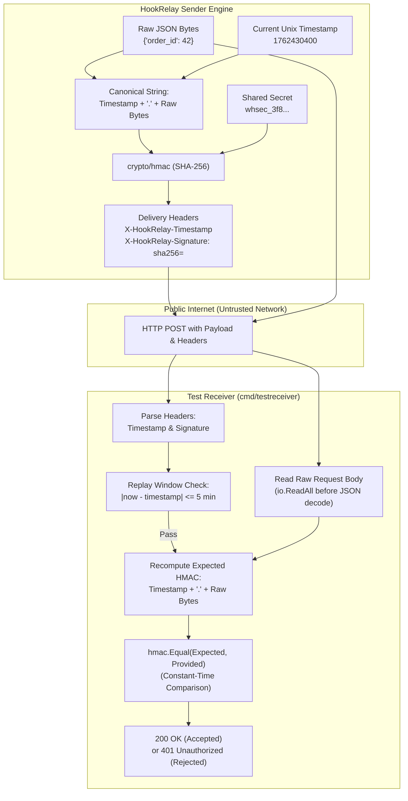
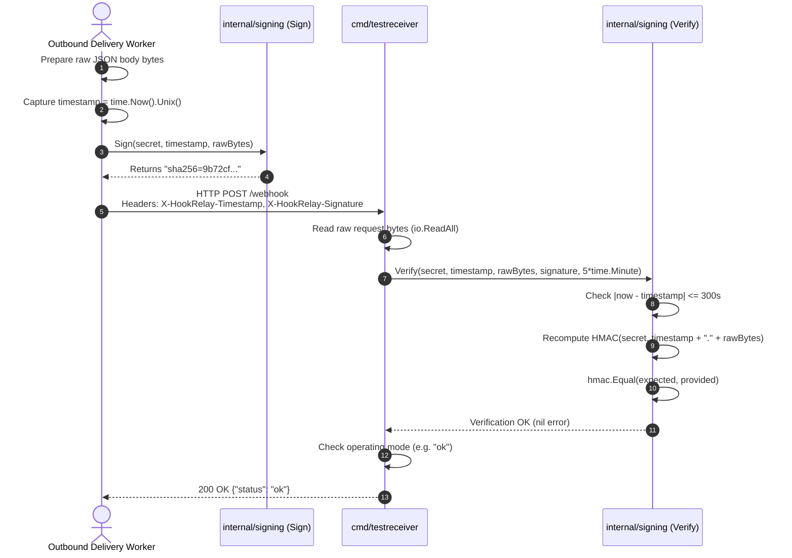

# Phase 3: Cryptography & The Webhook Delivery Contract — Learning Guide

Welcome to the learning companion for **Phase 3: Cryptography & The Webhook Delivery Contract** of HookRelay.

In Phase 1, we established our PostgreSQL foundation and data model. In Phase 2, we built the REST API for managing subscriber endpoints and generated write-only secrets. 

In Phase 3, we design and implement the **Webhook Delivery Contract**—the cryptographic specification that protects webhooks traveling across untrusted public networks. We also build a configurable **Test Receiver** to simulate real-world receiver behaviors (`ok`, `fail`, `slow`, `flaky`) and verify signatures in real time.

---

## 1. System Architecture & The Delivery Contract

When HookRelay delivers a webhook to a subscriber's URL, the request travels over the public internet. Two critical security questions arise:
1. **Authenticity:** How does the receiver know the request genuinely came from HookRelay and not an attacker pretending to be HookRelay?
2. **Integrity:** How does the receiver know the payload was not intercepted and altered in transit?
3. **Replay Protection:** How does the receiver know an attacker did not capture a valid delivery from three hours ago and re-send it to trigger duplicate actions?

HookRelay solves this using **HMAC-SHA256 signatures** combined with a **Unix epoch timestamp** signed over the **exact raw request bytes**.

### Delivery Header Specification

Every outbound webhook delivery sent by HookRelay includes standard metadata headers:

| Header | Example Value | Purpose |
| :--- | :--- | :--- |
| `Content-Type` | `application/json` | Standard JSON payload format |
| `X-HookRelay-Event-Id` | `evt_01HZX87K...` | Stable event ID (identical across all retries) for receiver deduplication |
| `X-HookRelay-Delivery-Id` | `1042` | Unique delivery identifier for this specific event and endpoint pair |
| `X-HookRelay-Attempt` | `1` | 1-based attempt sequence number (increments on retries) |
| `X-HookRelay-Timestamp` | `1762430400` | Unix epoch seconds when this attempt was signed |
| `X-HookRelay-Signature` | `sha256=a8f2c019...` | `sha256=<hex>` HMAC of `timestamp + "." + raw_body` |

### Architecture & Verification Flow



---

## 2. File-by-File Breakdown

### `internal/signing/signing.go`
- **Location:** `internal/signing/signing.go`
- **Purpose:** Pure cryptographic library implementing HookRelay's HMAC-SHA256 signing and verification contract.
- **What it does:** Provides pure functions to compute HMAC digests, format signature headers, and verify received payloads with replay-window checks and constant-time equality.
- **Important components:**
  - `Header*` constants: Centralized definitions for standard webhook headers (`X-HookRelay-Event-Id`, `X-HookRelay-Signature`, etc.).
  - `DefaultTolerance = 5 * time.Minute`: The maximum permissible age for incoming webhook deliveries to stop replay attacks.
  - `ComputeHMAC(secret, timestamp, body) []byte`: Hashes `timestamp + "." + body` using `crypto/hmac` and `crypto/sha256`.
  - `Sign(secret, timestamp, body) string`: Returns the complete header value formatted as `sha256=<hex>`.
  - `Verify(secret, timestamp, body, signatureHeader, tolerance) error`:
    1. Validates that `|now - timestamp| <= tolerance` (rejects expired or far-future timestamps).
    2. Ensures the signature header starts with `sha256=`.
    3. Decodes the hex string into raw bytes.
    4. Recomputes the expected HMAC bytes.
    5. Compares using `hmac.Equal` to prevent timing attacks.
- **Why this approach:** Keeping signing and verification in a pure, stateless package with zero external dependencies guarantees that it can be unit tested exhaustively with deterministic test vectors.

```go
func ComputeHMAC(secret string, timestamp int64, body []byte) []byte {
	mac := hmac.New(sha256.New, []byte(secret))
	mac.Write([]byte(strconv.FormatInt(timestamp, 10)))
	mac.Write([]byte("."))
	mac.Write(body)
	return mac.Sum(nil)
}

func Sign(secret string, timestamp int64, body []byte) string {
	macBytes := ComputeHMAC(secret, timestamp, body)
	return SignaturePrefix + hex.EncodeToString(macBytes)
}

func Verify(secret string, timestamp int64, body []byte, signatureHeader string, tolerance time.Duration) error {
	if tolerance > 0 {
		now := time.Now().Unix()
		tolSec := int64(tolerance.Seconds())
		if now-timestamp > tolSec {
			return ErrTimestampTooOld
		}
		if timestamp-now > tolSec {
			return ErrTimestampInFuture
		}
	}
	// ... prefix check and hex decode ...
	expectedMAC := ComputeHMAC(secret, timestamp, body)
	if !hmac.Equal(expectedMAC, providedMAC) {
		return ErrInvalidSignature
	}
	return nil
}
```

---

### `internal/signing/signing_test.go`
- **Location:** `internal/signing/signing_test.go`
- **Purpose:** Unit test suite covering all cryptographic and edge-case behaviors.
- **What it tests:**
  - `TestSign_KnownVector`: Verifies signature output against an independently computed HMAC-SHA256 test vector.
  - `TestVerify_Success`: Validates normal happy path verification.
  - `TestVerify_TamperedBody`: Confirms changing a single byte in the body fails verification (`ErrInvalidSignature`).
  - `TestVerify_TamperedTimestamp`: Confirms altering the timestamp by even 1 second fails verification.
  - `TestVerify_WrongSecret`: Confirms signing with secret A and verifying with secret B fails.
  - `TestVerify_ReplayAttack_ExpiredTimestamp`: Confirms requests older than 5 minutes fail with `ErrTimestampTooOld`.
  - `TestVerify_ClockSkew_FutureTimestamp`: Confirms timestamps 10 minutes in the future fail with `ErrTimestampInFuture`.
  - `TestVerify_InvalidSignatureFormat`: Tests rejection of missing `sha256=` prefix and malformed non-hex strings.
  - `TestVerify_ZeroTolerance_SkipsTimestampCheck`: Confirms setting `tolerance = 0` bypasses timestamp validation (useful for historic audits).

---

### `cmd/testreceiver/handler.go`
- **Location:** `cmd/testreceiver/handler.go`
- **Purpose:** Core HTTP handler for the standalone test receiver harness.
- **What it does:**
  - Intercepts webhook deliveries, logs request headers, and reads the raw body with `io.ReadAll`.
  - If a shared secret is configured, validates `X-HookRelay-Signature` and `X-HookRelay-Timestamp` using `signing.Verify`.
  - Simulates receiver failure modes (`ok`, `fail`, `slow`, `flaky`) selectable dynamically via query parameter (`?mode=...`) or header (`X-Test-Mode: ...`).
- **Modes supported:**
  - `ok`: Immediately returns `200 OK` with JSON `{"status": "ok", "mode": "ok"}`.
  - `fail`: Returns `500 Internal Server Error` with JSON `{"error": "simulated receiver failure", "mode": "fail"}`.
  - `slow`: Pauses execution for a configured duration (default 3 seconds, or via `?delay=200ms`) before returning `200 OK`.
  - `flaky`: Uses random failure simulation (50% probability) to simulate intermittent network or server faults.
- **Why this approach:** Having a dedicated, highly configurable test receiver lets us rigorously test timeouts, retry policies, and signature verification locally before deploying workers against production endpoints.

```go
// Verify signature if secret is configured
if secret != "" {
    timestamp, err := strconv.ParseInt(timestampStr, 10, 64)
    if err != nil {
        http.Error(w, `{"error": "invalid timestamp header"}`, http.StatusBadRequest)
        return
    }

    if err := signing.Verify(secret, timestamp, body, signature, signing.DefaultTolerance); err != nil {
        w.WriteHeader(http.StatusUnauthorized)
        _ = json.NewEncoder(w).Encode(map[string]string{
            "error":   "invalid signature",
            "details": err.Error(),
        })
        return
    }
}
```

---

### `cmd/testreceiver/main.go`
- **Location:** `cmd/testreceiver/main.go`
- **Purpose:** Entry point for running the test receiver as a standalone background process.
- **What it does:** Reads environment variables (`PORT`, `RECEIVER_MODE`, `RECEIVER_SECRET`), builds the handler, starts an `http.Server`, and supports graceful shutdown on `SIGINT` / `SIGTERM`.

---

### `cmd/testreceiver/handler_test.go`
- **Location:** `cmd/testreceiver/handler_test.go`
- **Purpose:** Automated unit and integration tests verifying the test receiver's behavior across all modes and signature verification scenarios using `httptest.NewRecorder`.

---

## 3. Core Backend Concepts Explained

### 1. HMAC-SHA256 (Hash-based Message Authentication Code)
In symmetric authentication, two parties share a common secret key. 

An HMAC is constructed as:
$$\text{HMAC}(K, m) = \text{SHA256}\left((K \oplus \text{opad}) \mathbin{\Vert} \text{SHA256}((K \oplus \text{ipad}) \mathbin{\Vert} m)\right)$$
Where $K$ is the secret key, $m$ is the message, and $\text{opad}$ and $\text{ipad}$ are standardized inner and outer padding constants.

**Why not simply hash `SHA256(secret + body)`?**
Naively concatenating `secret + body` is vulnerable to a cryptographic attack known as a **length-extension attack**. Hash functions based on the Merkle-Damgård construction allow an attacker who knows `SHA256(secret + body)` and the length of the secret to append data to the message and calculate a valid hash without ever knowing the secret! HMAC was mathematically proven to be immune to length-extension attacks.

### 2. Why Sign `timestamp + "." + raw_body`
If we only signed the payload body:
$$\text{Signature} = \text{HMAC}(K, \text{body})$$
An eavesdropper on the network (e.g., via compromised Wi-Fi, proxy, or logged HTTP traffic) could capture the valid request headers and payload. The attacker would not know the secret key, but they wouldn't need to: they could re-transmit the exact same HTTP POST to the receiver weeks later. The receiver would verify the signature, find it valid, and re-execute the action (e.g., fulfilling an order or crediting an account twice). This is a **replay attack**.

By prepending the Unix timestamp to the signature canonical string:
$$\text{Canonical} = \text{timestamp} + \text{"."} + \text{raw\_body}$$
$$\text{Signature} = \text{HMAC}(K, \text{Canonical})$$
1. The timestamp is bound to the signature: modifying the timestamp invalidates the HMAC.
2. The receiver checks if the timestamp is within a 5-minute tolerance window ($|t_{\text{now}} - t_{\text{signed}}| \le 300\text{s}$).
3. Any replayed request captured by an attacker becomes unusable after 5 minutes.

### 3. Constant-Time Comparison (`hmac.Equal`) vs Timing Attacks
When comparing two strings in Go:
```go
// INSECURE: Vulnerable to timing attack
if expectedSignature == providedSignature { ... }
```
The standard `==` operator compares bytes sequentially from left to right. The instant it finds a non-matching byte, it returns `false` immediately (**early exit**).

This creates a **timing side-channel leak**:
- If the 1st byte is wrong, the check takes 2 nanoseconds.
- If the 1st byte is right but the 2nd is wrong, the check takes 4 nanoseconds.
- By sending millions of requests and measuring response times with statistical precision, an attacker can guess the signature byte-by-byte without knowing the secret key!

**The solution:** `hmac.Equal(a, b)`:
```go
// SECURE: Constant-time comparison
if !hmac.Equal(expectedMAC, providedMAC) {
    return ErrInvalidSignature
}
```
`hmac.Equal` uses an XOR accumulator across all bytes, executing in the exact same number of CPU cycles regardless of where or whether differences exist.

### 4. The Critical Rule: Verify Against Raw Bytes
A frequent bug in webhook receiver implementations is decoding the JSON body first:
```go
// WRONG:
var payload map[string]interface{}
json.NewDecoder(r.Body).Decode(&payload)
// Re-marshaling does NOT reproduce original bytes!
reSerialized, _ := json.Marshal(payload)
Verify(secret, timestamp, reSerialized, signature) // FAILS!
```
JSON serializers do not preserve:
- Key ordering (e.g. `{"a":1,"b":2}` vs `{"b":2,"a":1}`)
- Whitespace and indentation (`{"id": 1}` vs `{"id":1}`)
- Floating-point representations (`10.0` vs `10`)

The HMAC was computed over the sender's exact wire bytes. **Receivers must read the raw body bytes (`io.ReadAll(r.Body)`) first, perform the cryptographic verification, and only then parse the JSON.**

### 5. Why Build a Test Receiver First
In distributed systems development, testing against remote third-party systems is slow, non-deterministic, and difficult to automate. By building `cmd/testreceiver` with deterministic fault modes:
- `slow`: We can verify that our outbound HTTP client enforces connect and read timeouts without hanging worker threads.
- `fail`: We can verify that our worker pool correctly transitions deliveries into retry backoff and eventually marks them `dead`.
- `flaky`: We can verify that exponential backoff eventually succeeds when a service recovers.

---

## 4. How Everything Connects (Step-by-Step Execution)



---

## 5. Learning Checklist & Self-Assessment

### Key Takeaways
- Webhook signatures provide authenticity (who sent it) and integrity (it was not modified).
- Timestamps prevent replay attacks by bounding validity to a narrow time window.
- Always use `hmac.Equal` instead of `==` to prevent timing attacks.
- Always sign and verify against **raw byte slices**, never re-serialized JSON.
- A test harness with configurable modes (`ok`, `fail`, `slow`, `flaky`) enables deterministic verification of retry and timeout mechanics.

### Important Terminology
- **HMAC (Hash-based Message Authentication Code):** A mechanism for message authentication using cryptographic hash functions combined with a shared secret.
- **Length-Extension Attack:** An exploit against Merkle-Damgård hash functions (like raw SHA-256) where an attacker appends data to a message without knowing the secret.
- **Replay Attack:** A network attack where valid data transmission is recorded and maliciously repeated.
- **Timing Side-Channel Attack:** An attack where an adversary measures microsecond differences in execution time to deduce secret keys or signatures.
- **Canonicalization:** The process of standardizing data into a consistent, unambiguous format before signing.

### Questions You Should Be Able to Answer
1. Why is `SHA256(secret + body)` vulnerable to length-extension attacks while `HMAC-SHA256(secret, body)` is secure?
2. If an attacker captures a valid signed webhook request, why can't they replay it 20 minutes later?
3. How does `hmac.Equal` prevent timing attacks compared to the standard Go `==` operator?
4. Why will signature verification fail if the receiver deserializes JSON into a Go struct and re-marshals it before verification?
5. How does the `slow` mode in `cmd/testreceiver` help test the outbound HTTP client in future phases?

### Areas to Investigate Further
- **Asymmetric Webhooks (Ed25519 / RSA):** Research why companies like Svix or Standard Webhooks recommend asymmetric signatures (public/private key pairs) so receivers don't have to share secrets with senders.
- **Secret Rotation with Multiple Active Signatures:** How can senders support dual-secret transitions by sending two signatures in the `X-HookRelay-Signature` header (e.g., `v1,t=... s=...; v2,t=... s=...`)?
- **Mutual TLS (mTLS):** How does mTLS compare with application-layer HMAC signatures for securing server-to-server webhook delivery?
