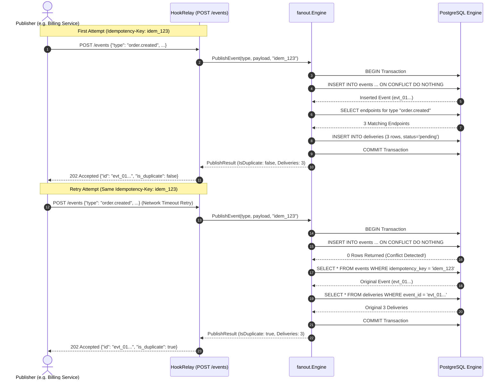

# Phase 4: Event Ingest Idempotency & Transactional Fan-Out — Learning Guide

Welcome to the learning companion for **Phase 4: Event Ingest Idempotency & Transactional Fan-Out** of HookRelay.

In Phase 1, we built our PostgreSQL schema with strict integrity constraints. In Phase 2, we built the endpoint management API. In Phase 3, we implemented HMAC-SHA256 signing and the test receiver.

In Phase 4, we build the core event ingestion and fan-out engine:
1. **Immediate Ingest (`POST /events`):** Ingests events asynchronously, returning `202 Accepted` in milliseconds without blocking on HTTP delivery.
2. **Ingest Idempotency:** Guarantees that clients retrying identical requests with an `Idempotency-Key` header never produce duplicate events or duplicate deliveries.
3. **Atomic 1-to-N Fan-Out:** Within a single ACID database transaction, matches all subscribed active endpoints (including wildcard subscribers) and inserts corresponding `pending` deliveries.
4. **Monotonic Event Identifiers (`internal/id`):** Time-sortable IDs (`evt_<unix_ms><seq><random>`) optimized for B-tree index locality.

---

## 1. System Architecture & The Fan-Out Pipeline

In a webhook system, publishing an event is an **asynchronous handoff**. The publishing client should never wait for HookRelay to dial external third-party subscriber URLs—some of those URLs might be slow, down, or unresponsive.

Instead, HookRelay:
1. Accepts the payload immediately.
2. Atomically fans out one `deliveries` record for each matching subscriber.
3. Returns `202 Accepted` to the client.
4. Leaves the actual HTTP deliveries for background workers to process independently.

### Architecture Diagram

```mermaid
flowchart TD
    subgraph Publisher["Event Publisher"]
        Client["Client / API Caller\nPOST /events (Header: Idempotency-Key)"]
    end

    subgraph API["HookRelay Ingest API (internal/api)"]
        Handler["PublishEventHandler"]
    end

    subgraph FanOutEngine["Transactional Engine (internal/fanout)"]
        Tx["Begin PostgreSQL Transaction (ACID)"]
        InsertEvt["1. INSERT INTO events\nON CONFLICT (idempotency_key) DO NOTHING"]
        MatchEndpoints["2. SELECT * FROM endpoints\nWHERE active=true AND (all OR type=ANY)"]
        CreateDeliveries["3. INSERT INTO deliveries\n(event_id, endpoint_id, status='pending')"]
        CommitTx["4. Commit Transaction"]
    end

    subgraph DB["PostgreSQL 16"]
        EventsTable["events Table\n(Unique idempotency_key)"]
        EndpointsTable["endpoints Table\n(Active subscribers)"]
        DeliveriesTable["deliveries Table\n(Unique event_id, endpoint_id)"]
    end

    Client -->|POST /events| Handler
    Handler -->|PublishEvent(params)| Tx
    Tx --> InsertEvt
    InsertEvt --> EventsTable
    InsertEvt -->|Success| MatchEndpoints
    MatchEndpoints --> EndpointsTable
    MatchEndpoints -->|Matching List| CreateDeliveries
    CreateDeliveries --> DeliveriesTable
    CreateDeliveries --> CommitTx
    CommitTx -->|PublishResult| Handler
    Handler -->>|202 Accepted JSON| Client
```

### Idempotency & Deduplication Sequence



---

## 2. File-by-File Breakdown

### `internal/id/id.go`
- **Location:** `internal/id/id.go`
- **Purpose:** Generates unique, time-sortable event identifiers.
- **What it does:** Produces monotonic IDs formatted as `evt_<12_hex_timestamp_ms><4_hex_seq><8_hex_random>` (e.g. `evt_0192f1b4a3c8000198d2e14f`).
- **Important components:**
  - `EventPrefix = "evt_"`: Clear prefix namespace.
  - `atomic.AddUint32(&seq, 1) & 0xffff`: A 16-bit sequence counter ensuring that multiple events generated during the exact same millisecond remain strictly ordered and non-colliding.
  - `rand.Read(b)`: 32 bits of cryptographic randomness providing cross-instance entropy in multi-node deployments.
- **Why this approach:** Random UUIDs (UUIDv4) scatter insertions randomly across database B-tree indexes, causing page splits and cache churn. Time-prefixed IDs ensure sequential index appends, drastically improving write throughput.

```go
var seq uint32

func NewEventID() string {
	nowMs := uint64(time.Now().UnixMilli())
	s := atomic.AddUint32(&seq, 1) & 0xffff
	b := make([]byte, 4)
	if _, err := rand.Read(b); err != nil {
		return fmt.Sprintf("%s%012x%04x%08d", EventPrefix, nowMs, s, time.Now().UnixNano()%100000000)
	}
	return fmt.Sprintf("%s%012x%04x%s", EventPrefix, nowMs, s, hex.EncodeToString(b))
}
```

---

### `internal/fanout/fanout.go`
- **Location:** `internal/fanout/fanout.go`
- **Purpose:** Encapsulates the transactional logic connecting event ingestion to delivery creation.
- **What it does:**
  - Begins a PostgreSQL transaction.
  - Inserts into `events` with `ON CONFLICT (idempotency_key) DO NOTHING`.
  - On conflict: queries the original event and its deliveries, commits, and returns `IsDuplicate: true`.
  - On success: queries all active endpoints matching the event type (including wildcards with empty `event_types`), inserts a pending delivery for each, commits, and returns `IsDuplicate: false`.
- **Important components:**
  - `Engine struct`: Backed by `*pgxpool.Pool`.
  - `PublishEvent(ctx, params) (*PublishResult, error)`: The primary atomic entry point.
- **Why this approach:** Encapsulating fan-out in a dedicated package keeps HTTP handlers lean and enables testing fan-out logic directly without HTTP overhead.

```go
// 1. Attempt to insert event with ON CONFLICT (idempotency_key) DO NOTHING
event, err := qtx.CreateEvent(ctx, store.CreateEventParams{
    ID:             eventID,
    Type:           params.Type,
    Payload:        params.Payload,
    IdempotencyKey: idemKey,
})

if err != nil {
    if errors.Is(err, pgx.ErrNoRows) && idemKey.Valid {
        // Idempotency conflict: fetch original and return
        existingEvent, _ := qtx.GetEventByIdempotencyKey(ctx, idemKey)
        existingDeliveries, _ := qtx.ListDeliveriesByEventID(ctx, existingEvent.ID)
        _ = tx.Commit(ctx)
        return &PublishResult{
            Event:       existingEvent,
            Deliveries:  existingDeliveries,
            IsDuplicate: true,
        }, nil
    }
    return nil, err
}

// 2. Fan-out to matching active endpoints
matchingEndpoints, _ := qtx.ListActiveEndpointsForEventType(ctx, params.Type)
for _, ep := range matchingEndpoints {
    deliv, _ := qtx.CreateDelivery(ctx, store.CreateDeliveryParams{
        EventID:    event.ID,
        EndpointID: ep.ID,
    })
    deliveries = append(deliveries, deliv)
}
_ = tx.Commit(ctx)
```

---

### `internal/api/types.go`
- **Location:** `internal/api/types.go`
- **Purpose:** Data Transfer Objects (DTOs) for event publishing, retrieval, and delivery inspection.
- **Important components:**
  - `PublishEventRequest`: Accepts `type` and either `payload` or `data`.
  - `PublishEventResponse`: Returns `202 Accepted` status with `id`, `deliveries_count`, and `is_duplicate`.
  - `EventResponse`: Detailed model returning the event, its JSON payload, and all child `deliveries`.
  - `DeliveryResponse`: Represents a delivery task with status, attempt counter, timestamps, and child `attempts_history`.

---

### `internal/api/handlers.go`
- **Location:** `internal/api/handlers.go`
- **Purpose:** Exposes event publishing and inspection via REST.
- **Important handlers added:**
  - `PublishEventHandler`: Reads optional `Idempotency-Key` header, delegates to `s.fanout.PublishEvent`, and returns `202 Accepted`.
  - `GetEventByIDHandler`: Retrieves event details and all generated delivery rows.
  - `GetDeliveryByIDHandler`: Retrieves delivery state and its full attempt execution audit history.

---

### `internal/api/server.go`
- **Location:** `internal/api/server.go`
- **Purpose:** Routes HTTP paths to the new event handlers:
  - `POST /events` -> `s.PublishEventHandler`
  - `GET /events/:id` -> `s.GetEventByIDHandler`
  - `GET /deliveries/:id` -> `s.GetDeliveryByIDHandler`

---

### `internal/fanout/fanout_test.go` & `internal/api/api_test.go`
- **Location:** `internal/fanout/fanout_test.go` and `internal/api/api_test.go`
- **Purpose:** Comprehensive integration test suites.
- **What they verify:**
  - Single event fans out to multiple subscribed endpoints.
  - Mismatched event types and inactive endpoints are ignored.
  - Wildcard endpoints (`event_types = '{}'`) receive all events.
  - Re-sending an event with the same `Idempotency-Key` returns the original event ID with `is_duplicate: true` and creates zero duplicate deliveries.
  - `GET /events/:id` and `GET /deliveries/:id` return correct hierarchical responses.

---

## 3. Core Backend Concepts Explained

### 1. The Power of `202 Accepted`
In synchronous REST APIs, `POST` typically returns `201 Created` or `200 OK` after the requested action is fully executed.

However, in webhook and event brokers, **delivery over HTTP involves remote third-party networks**. If a subscriber endpoint is experiencing an outage or responding in 10 seconds, holding the publisher's HTTP connection open would:
- Exhaust publisher connection pools.
- Back up ingress web servers.
- Cascade latency upstream into user-facing operations (e.g. checkout).

Returning `202 Accepted`:
- Tells the publisher: *"Your event has been durably persisted and accepted for processing."*
- Decouples event ingestion from external delivery latency.

### 2. Idempotency at the Database Layer vs Application Checks
Why can't we simply do this in application code?
```go
// INSECURE & BUG-PRONE: Classic Race Condition!
existing, err := db.FindEventByIdempotencyKey(key)
if existing != nil {
    return existing // already exists
}
db.InsertEvent(key, ...) // RACE WINDOW HERE!
```
If two identical requests arrive simultaneously on two separate server instances:
1. Both execute `FindEventByIdempotencyKey` concurrently.
2. Both receive `nil` (event does not exist yet).
3. Both proceed to `InsertEvent`.
4. Both succeed (or one throws an unhandled duplicate key error), and duplicate deliveries are fanned out!

**The solution:** Rely on the database's atomic uniqueness constraints:
```sql
INSERT INTO events (id, type, payload, idempotency_key)
VALUES ($1, $2, $3, $4)
ON CONFLICT (idempotency_key) DO NOTHING
RETURNING *;
```
PostgreSQL locks the specific index leaf during the insert. Exactly one query succeeds; the second becomes a harmless no-op. The application then detects that zero rows were returned and fetches the original record.

### 3. Transactional Fan-Out (ACID Atomicity)
What happens if the server crashes while fanning out deliveries?
If event insertion and delivery creation were in separate transactions:
1. Event is inserted into `events`.
2. Server crashes or network blips before `deliveries` are inserted.
3. The event sits in the database as an "orphan"—it exists, but no deliveries were ever scheduled for it. It will never be delivered!

By wrapping the event insert, endpoint lookup, and delivery inserts into **one single transaction (`BEGIN` ... `COMMIT`)**:
- Either the event **and all its deliveries** are durably committed together.
- Or if any step fails, the entire transaction rolls back cleanly, leaving zero orphaned records.

### 4. Wildcard Subscriptions with Array Cardinality
In PostgreSQL, endpoints specify subscribed events via a text array:
```sql
event_types TEXT[] NOT NULL DEFAULT '{}'
```
Instead of requiring a complicated topic-matching microservice, we query:
```sql
SELECT * FROM endpoints
WHERE active = true
  AND (cardinality(event_types) = 0 OR $1::text = ANY(event_types))
ORDER BY id ASC;
```
- If an endpoint has `event_types = '{}'` (length 0), `cardinality(event_types) = 0` evaluates to `true`, matching **every** event.
- If an endpoint specifies `{'order.created', 'order.paid'}`, `$1 = ANY(event_types)` matches only if the published event type is in the array.

### 5. Time-Sorted Lexicographical Identifiers
Why use `evt_<unix_ms><seq><random>` instead of standard UUIDv4?
- **B-tree Page Locality:** PostgreSQL indexes rows using B-trees. Random UUIDv4 keys insert data at random positions across the tree, forcing constant disk page reads and writes (write amplification).
- **Sequential Clustering:** Because our IDs start with hexadecimal Unix milliseconds (`nowMs`), new events always append to the right edge of the B-tree index. Index pages stay warm in CPU cache.
- **Natural Chronological Ordering:** Querying `ORDER BY id ASC` naturally sorts events by creation time without requiring an extra index on `created_at`.

---

## 4. How Everything Connects (Data Flow)

```mermaid
flowchart LR
    subgraph Publisher
        Request["POST /events\nIdempotency-Key: pay_abc"]
    end

    subgraph API
        Handler["PublishEventHandler"]
    end

    subgraph Engine
        Fanout["PublishEvent()"]
    end

    subgraph DatabaseTransaction["Single Atomic DB Transaction"]
        EventInsert["Insert Event\nON CONFLICT DO NOTHING"]
        MatchEndpoints["Find Matching Active Endpoints"]
        CreateDeliveries["Insert Pending Deliveries\n(One per matching endpoint)"]
    end

    subgraph Queue["Pending Deliveries Queue"]
        PendingRow1["Delivery 1 (Endpoint 12)"]
        PendingRow2["Delivery 2 (Endpoint 34)"]
    end

    Request --> Handler
    Handler --> Fanout
    Fanout --> EventInsert
    EventInsert --> MatchEndpoints
    MatchEndpoints --> CreateDeliveries
    CreateDeliveries --> PendingRow1
    CreateDeliveries --> PendingRow2
    Fanout -->>|202 Accepted| Handler
    Handler -->>|Response| Request
```

---

## 5. Learning Checklist & Self-Assessment

### Key Takeaways
- Event ingestion in webhook engines must be asynchronous (`202 Accepted`) to insulate publishers from subscriber network conditions.
- True idempotency requires pushing deduplication down to database constraints (`ON CONFLICT`).
- Transactional fan-out guarantees that events and their delivery tasks are committed atomically, preventing orphaned events.
- Time-sortable IDs (`evt_...`) optimize B-tree index locality compared to random UUIDs.
- Array cardinality (`cardinality(event_types) = 0`) provides clean wildcard subscription mechanics in PostgreSQL.

### Important Terminology
- **Fan-Out:** The pattern of taking a single incoming message and replicating it to multiple destinations or queues.
- **Ingest Idempotency:** The property where an API endpoint can receive the exact same request repeatedly without producing side effects beyond the initial request.
- **ACID Atomicity:** The guarantee that a series of database operations either all succeed together or all fail together.
- **Write Amplification:** The phenomenon where a small amount of data written causes multiple disk blocks or index pages to be updated across storage.
- **Orphan Record:** A record in a database that lacks corresponding parent or child records necessary for the system to process it.

### Questions You Should Be Able to Answer
1. Why does `POST /events` return `202 Accepted` rather than `201 Created` or `200 OK`?
2. If two identical requests with the same `Idempotency-Key` hit two separate server instances simultaneously, how does PostgreSQL guarantee that only one event is created?
3. What is the risk of performing event insertion and delivery creation in separate database transactions?
4. How does `cardinality(event_types) = 0` allow an endpoint to subscribe to all events as a wildcard?
5. Why do sequential time-prefixed IDs perform better in PostgreSQL indexes than random UUIDv4 identifiers?

### Areas to Investigate Further
- **Event Topic Hierarchies (Wildcard Matching):** Investigate how systems like RabbitMQ or Kafka support hierarchical topic wildcards like `order.*` or `order.#` using PostgreSQL pattern matching or ltree extensions.
- **Bulk Delivery Inserts (`COPY` / Multi-Row `INSERT`):** If an event fans out to 10,000 subscribers, how would you optimize delivery creation from individual inserts to batch `INSERT INTO deliveries SELECT ...`?
- **Dead-Letter Idempotency Cleanup:** How should expired idempotency keys be pruned after 24–48 hours to prevent unbounded table growth?
