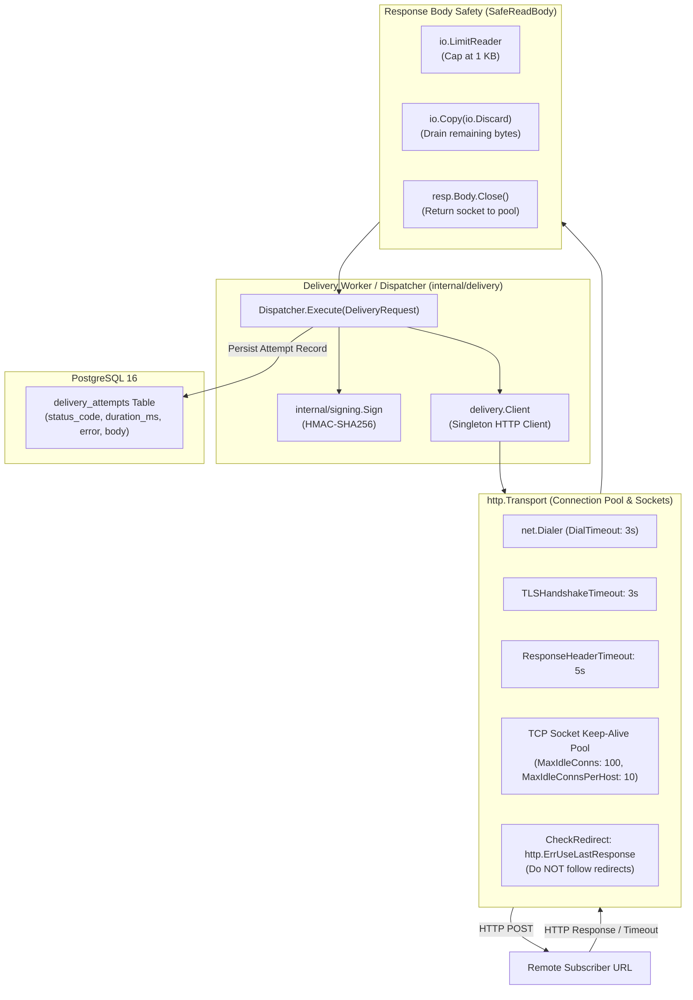
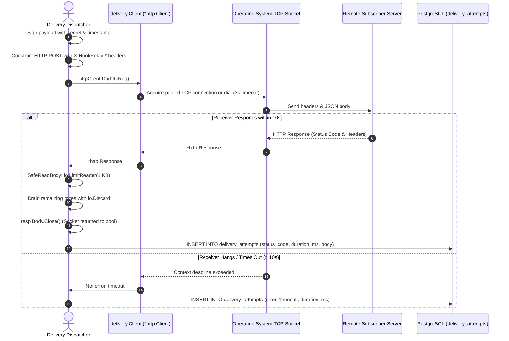

# Phase 5: Production-Grade Outbound HTTP Client Mechanics — Learning Guide

Welcome to the learning companion for **Phase 5: Production-Grade Outbound HTTP Client Mechanics** of HookRelay.

In Phase 1, we established our database foundation. In Phase 2, we built the REST API. In Phase 3, we designed HMAC-SHA256 signatures and the test receiver. In Phase 4, we built event ingestion and transactional fan-out.

In Phase 5, we tackle **one of the most critical topics in Go backend engineering**: properly configuring outbound HTTP communication with untrusted, remote servers. We implement custom transport tuning, socket connection pooling, memory-bounded response body reads, strict redirect isolation, and durable attempt auditing.

---

## 1. System Architecture & The Outbound Pipeline

HookRelay talks to servers it does not control. Third-party subscriber endpoints can be slow, misconfigured, malicious, or completely unresponsive. 

If an outbound HTTP client is misconfigured, a single hanging receiver can:
1. Stall an entire worker goroutine indefinitely.
2. Leak open TCP sockets until the operating system runs out of file descriptors (`too many open files`).
3. Cause an Out-Of-Memory (OOM) crash by returning a 500 MB response body.
4. Lead to Server-Side Request Forgery (SSRF) by redirecting requests into internal private networks.

HookRelay's delivery module (`internal/delivery`) solves these challenges using a tuned `http.Transport`, connection pooling, bounded reads, and automatic attempt logging.

### Architecture Diagram



### Execution Flow Sequence



---

## 2. File-by-File Breakdown

### `internal/delivery/client.go`
- **Location:** `internal/delivery/client.go`
- **Purpose:** Configures and manages the shared outbound HTTP client and connection pool.
- **What it does:** Replaces Go's unbounded default HTTP client with a tuned, production-grade `*http.Client` featuring granular network timeouts, keep-alive pooling, and redirect suppression.
- **Important components:**
  - `ClientConfig`: Strongly typed network configuration:
    - `Timeout: 10 * time.Second`: Overall deadline for the entire request lifecycle.
    - `DialTimeout: 3 * time.Second`: Deadline to establish the raw TCP connection.
    - `TLSHandshakeTimeout: 3 * time.Second`: Deadline for the TLS cryptographic handshake.
    - `ResponseHeaderTimeout: 5 * time.Second`: Deadline waiting for the receiver to send response headers after the request body has been fully written.
    - `MaxIdleConns: 100` / `MaxIdleConnsPerHost: 10`: Keeps healthy TCP connections open in a warm pool for immediate reuse.
    - `MaxResponseBodyBytes: 1024`: Binds memory allocation to 1 KB max.
  - `CheckRedirect: http.ErrUseLastResponse`: Prevents following HTTP 301/302/307 redirects.
  - `SafeReadBody(body, maxBytes) (string, error)`: Helper function implementing the **drain and close** pattern with `io.LimitReader`.
- **Why this approach:** Webhook senders must strictly isolate themselves from subscriber infrastructure failures. Reusing a properly tuned client prevents socket starvation while defending against slow-loris receivers.

```go
func NewClient(cfg ClientConfig) *Client {
	transport := &http.Transport{
		Proxy: http.ProxyFromEnvironment,
		DialContext: (&net.Dialer{
			Timeout:   cfg.DialTimeout,
			KeepAlive: 30 * time.Second,
		}).DialContext,
		ForceAttemptHTTP2:     true,
		MaxIdleConns:          cfg.MaxIdleConns,
		MaxIdleConnsPerHost:   cfg.MaxIdleConnsPerHost,
		IdleConnTimeout:       cfg.IdleConnTimeout,
		TLSHandshakeTimeout:   cfg.TLSHandshakeTimeout,
		ResponseHeaderTimeout: cfg.ResponseHeaderTimeout,
	}

	httpClient := &http.Client{
		Transport: transport,
		Timeout:   cfg.Timeout,
		CheckRedirect: func(req *http.Request, via []*http.Request) error {
			return http.ErrUseLastResponse
		},
	}

	return &Client{
		httpClient:           httpClient,
		maxResponseBodyBytes: cfg.MaxResponseBodyBytes,
	}
}
```

---

### `internal/delivery/dispatcher.go`
- **Location:** `internal/delivery/dispatcher.go`
- **Purpose:** Executes signed webhook deliveries and records audit attempt logs in PostgreSQL.
- **What it does:**
  1. Computes the HMAC-SHA256 signature over `timestamp + "." + raw_payload`.
  2. Builds the `http.Request` with `http.NewRequestWithContext` and attaches all delivery contract headers (`X-HookRelay-*`).
  3. Executes the request via `client.httpClient.Do(httpReq)`.
  4. Times execution latency down to the millisecond (`duration_ms`).
  5. Safely reads and truncates the response body using `SafeReadBody`.
  6. Inserts an immutable attempt record into `delivery_attempts` table.
- **Important types:**
  - `DeliveryRequest`: Holds delivery ID, endpoint URL, secret, event payload, and attempt number.
  - `DeliveryResult`: Holds status code, duration, error string, truncated body, and success boolean (`2xx`).
  - `Dispatcher`: Coordinates client, store queries, and logger.
- **Why this approach:** Encapsulating request signing, HTTP execution, and attempt auditing into a single `Execute` method ensures consistent telemetry and guarantees that every network attempt is durably recorded regardless of outcome.

```go
func (d *Dispatcher) Execute(ctx context.Context, req DeliveryRequest) (*DeliveryResult, error) {
	startedAt := time.Now()
	timestamp := startedAt.Unix()

	// 1. Sign payload
	signature := signing.Sign(req.Secret, timestamp, req.Payload)

	// 2. Build HTTP request with caller context
	httpReq, err := http.NewRequestWithContext(ctx, http.MethodPost, req.URL, bytes.NewReader(req.Payload))
	if err != nil {
		return nil, err
	}

	// 3. Attach delivery headers
	httpReq.Header.Set("Content-Type", "application/json")
	httpReq.Header.Set(signing.HeaderEventID, req.EventID)
	httpReq.Header.Set(signing.HeaderDeliveryID, strconv.FormatInt(req.DeliveryID, 10))
	httpReq.Header.Set(signing.HeaderAttempt, strconv.FormatInt(int64(req.Attempt), 10))
	httpReq.Header.Set(signing.HeaderTimestamp, strconv.FormatInt(timestamp, 10))
	httpReq.Header.Set(signing.HeaderSignature, signature)
	httpReq.Header.Set("User-Agent", "HookRelay/1.0")

	// 4. Execute outbound HTTP POST
	resp, doErr := d.client.httpClient.Do(httpReq)
	duration := time.Since(startedAt)

	// 5. Read response & record attempt in delivery_attempts table
    // ...
}
```

---

### `internal/delivery/delivery_test.go`
- **Location:** `internal/delivery/delivery_test.go`
- **Purpose:** Integration test suite validating client behavior, redirect blocking, timeout mechanics, and attempt logging.
- **What it tests:**
  - `TestClient_RedirectsNotFollowed`: Proves that 301/302 redirects are not followed and return the 302 status code directly.
  - `TestDispatcher_SuccessfulDeliveryAndAttemptLogging`: Verifies that successful deliveries transmit all required headers, receive the response, and persist a 200 attempt row in PostgreSQL.
  - `TestDispatcher_TimeoutOnSlowReceiver`: Verifies that a hung receiver times out at the configured client deadline and logs an error in PostgreSQL without blocking indefinitely.
  - `TestDispatcher_BoundedBodyRead`: Verifies that a 10 KB response is cleanly truncated to the configured limit (512 bytes) without memory exhaustion.

---

## 3. Core Backend Concepts Explained

### 1. The Dangers of `http.DefaultClient` in Go
Go's standard library provides a global default HTTP client: `http.DefaultClient`. Many beginners use it or call `http.Post` directly.

**In production, `http.DefaultClient` is dangerous:**
```go
// In Go's net/http package:
var DefaultClient = &Client{} // Timeout = 0 (INFINITY!)
```
`DefaultClient` has **no timeout**. If a remote receiver accepts a TCP connection and then stalls (either by sending zero bytes or sending 1 byte every 5 minutes), the calling Go goroutine will wait forever. In a background worker pool, all worker threads will eventually become stuck waiting on dead sockets, freezing the entire application!

**Rule:** Always instantiate a custom `*http.Client` with explicit timeouts.

### 2. Low-Level Transport Timeouts: Where Can Latency Occur?
An HTTP request involves multiple network phases:
1. **DNS Resolution & TCP Dialing:** Resolving the hostname and completing the TCP 3-way handshake (`SYN`, `SYN-ACK`, `ACK`). Controlled by `net.Dialer.Timeout` (e.g. 3s).
2. **TLS Handshake:** Performing cryptographic negotiation on HTTPS connections. Controlled by `Transport.TLSHandshakeTimeout` (e.g. 3s).
3. **Response Headers:** Waiting for the remote server to process the request and send the HTTP response status code and headers. Controlled by `Transport.ResponseHeaderTimeout` (e.g. 5s).
4. **End-to-End Deadline:** The total permissible time from dialing through reading the final byte of the response body. Controlled by `Client.Timeout` (e.g. 10s).

Configuring these granular timeouts ensures that failures are detected quickly at the specific phase where they occur.

### 3. Connection Pooling & Socket Reuse (Keep-Alive)
Establishing a new TCP connection requires network round-trips; establishing an HTTPS connection requires additional round-trips for the TLS handshake. Doing this for every webhook delivery creates massive latency and exhausts ephemeral ports.

`http.Transport` maintains an internal pool of open, idle TCP connections:
- `MaxIdleConns`: The total number of idle connections cached across all domains.
- `MaxIdleConnsPerHost`: The maximum number of idle connections cached for a single domain. (Go's default is 2, which is often too low for high-throughput endpoints!).
- `IdleConnTimeout`: Closes connections that have been idle longer than a specified duration (e.g., 90s) to free operating system resources.

**Crucial Rule:** The `*http.Client` must be created **once as a singleton** and shared across workers. If you create `&http.Client{}` inside a function loop, a new connection pool is created on every call, completely defeating connection reuse.

### 4. The "Drain and Close" Rule: Preventing Socket Leaks
Why is closing `resp.Body` not enough?
```go
// WRONG: Leaks the connection from the pool!
resp, _ := client.Do(req)
resp.Body.Close()
```
In HTTP/1.1 Keep-Alive, the underlying TCP socket can only be reused for another request if the current HTTP response has been **completely read to End-Of-File (`io.EOF`)**. 

If you close the body before reading to EOF, the Go runtime cannot know if there are unread bytes still coming down the socket. It is forced to close the entire TCP connection rather than returning it to the pool!

```go
// CORRECT: SafeReadBody pattern
func SafeReadBody(body io.ReadCloser, maxBytes int64) (string, error) {
    defer body.Close()
    // 1. Read up to maxBytes
    limitReader := io.LimitReader(body, maxBytes)
    data, _ := io.ReadAll(limitReader)
    // 2. Drain remaining bytes to EOF
    _, _ = io.Copy(io.Discard, io.LimitReader(body, 32*1024))
    return string(data), nil
}
```

### 5. Memory Bounding with `io.LimitReader`
What happens if a malicious subscriber returns an infinite stream of random bytes or a 200 MB file?
If we called `io.ReadAll(resp.Body)`, the Go process would allocate memory until it exhausted available RAM and was killed by the OS Out-Of-Memory (OOM) killer.

`io.LimitReader(resp.Body, 1024)` wraps the body reader and returns `io.EOF` after exactly 1,024 bytes. Our database logs the first 1 KB of the response (useful for developer debugging), while the application's RAM remains safe.

### 6. Redirect Policy: Why Webhook Senders Reject Redirects
If a subscriber registers `https://example.com/webhook`, and that server responds with `302 Found -> Location: http://169.254.169.254/latest/meta-data`:
- An automatic redirect follower would silently re-send the request to the cloud metadata address, creating a severe **Server-Side Request Forgery (SSRF)** vulnerability.
- A 302 redirect can convert a `POST` request into a `GET` request, dropping the payload body entirely.

By configuring:
```go
CheckRedirect: func(req *http.Request, via []*http.Request) error {
    return http.ErrUseLastResponse
}
```
The client treats any 3xx response as a final response without following it.

---

## 4. How Everything Connects (Component Interaction)

```mermaid
flowchart LR
    subgraph HookRelay
        Worker["Worker Goroutine"]
        Dispatcher["Dispatcher"]
        Client["Outbound Client"]
        Store["internal/store"]
    end

    subgraph Remote["External Subscriber"]
        Endpoint["Subscriber URL\n(http.Server)"]
    end

    Worker -->|Execute(DeliveryRequest)| Dispatcher
    Dispatcher -->|POST Request with HMAC| Client
    Client -->|Pooled TCP Socket| Endpoint
    Endpoint -->>|Status 200 / 500 / Timeout| Client
    Client -->>|SafeReadBody (1 KB)| Dispatcher
    Dispatcher -->|CreateDeliveryAttempt()| Store
    Store -->>|Attempt ID| Dispatcher
    Dispatcher -->>|DeliveryResult| Worker
```

---

## 5. Learning Checklist & Self-Assessment

### Key Takeaways
- Never use `http.DefaultClient` in production Go backend services.
- Always configure granular timeouts (`DialTimeout`, `TLSHandshakeTimeout`, `ResponseHeaderTimeout`, and total `Timeout`).
- Reuse a single `*http.Client` instance across your application to leverage HTTP connection pooling.
- Always drain (`io.Copy(io.Discard, ...)`) and close `resp.Body` to allow TCP socket reuse.
- Use `io.LimitReader` to protect your process from unbounded memory allocation on responses.
- Reject automatic redirect following (`http.ErrUseLastResponse`) to prevent SSRF and payload drop bugs.

### Important Terminology
- **TCP Keep-Alive:** A mechanism that keeps a single TCP connection open across multiple HTTP request/response cycles.
- **Connection Starvation:** A condition where all available network sockets or connection pool slots are occupied, preventing new requests from being initiated.
- **Drain and Close:** The practice of reading an HTTP response stream to `EOF` before closing it, enabling the Go transport to recycle the underlying TCP socket.
- **io.LimitReader:** An `io.Reader` wrapper that reads at most $N$ bytes from an underlying stream, returning `io.EOF` once the limit is reached.
- **ResponseHeaderTimeout:** The time allowed for the remote server to write the HTTP response status code and headers after receiving the request.

### Questions You Should Be Able to Answer
1. Why does using `http.DefaultClient` risk locking up an entire backend service?
2. What is the difference between `ResponseHeaderTimeout` and overall `Client.Timeout`?
3. What happens to Go's connection pool if you call `resp.Body.Close()` without reading the response body to EOF?
4. How does `io.LimitReader` protect a backend service from memory exhaustion (OOM)?
5. Why should a webhook delivery engine refuse to follow HTTP redirects automatically?

### Areas to Investigate Further
- **HTTP/2 & HTTP/3 (QUIC) Multiplexing:** How do HTTP/2 multiplexed streams compare with HTTP/1.1 Keep-Alive connection pools under high webhook volume?
- **Custom Dialers for DNS Caching:** Explore how custom `net.Dialer` implementations can cache DNS lookups locally to eliminate DNS resolution latency on repeated deliveries.
- **TLS Client Certificates (mTLS):** How would you configure `tls.Config` inside `http.Transport` to authenticate HookRelay to receivers using mutual TLS?
