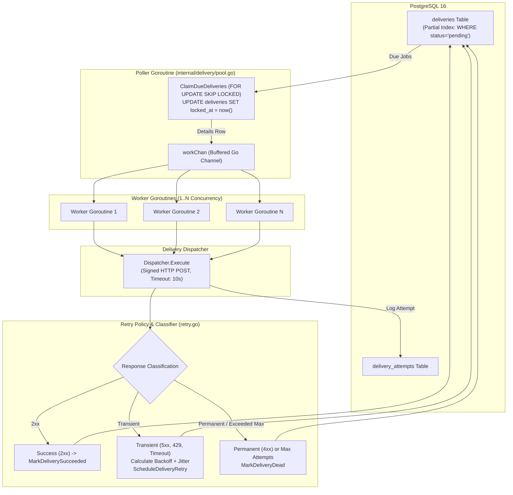
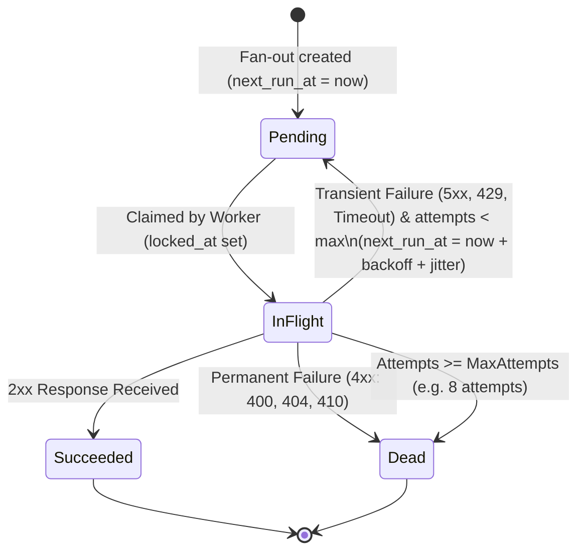
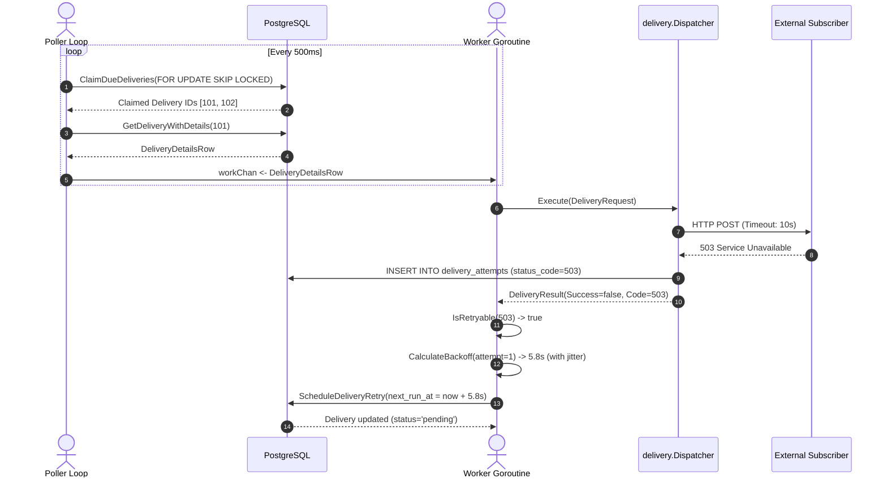

# Phase 6: Reliable Delivery Worker Pool & Retry Dynamics — Learning Guide

Welcome to the learning companion for **Phase 6: Reliable Delivery Worker Pool & Retry Dynamics** of HookRelay.

In Phase 1 through Phase 5, we built the database schema, endpoint CRUD, signing contract, test receiver, transactional fan-out engine, and tuned outbound HTTP client. 

In Phase 6, we assemble the delivery engine's beating heart: the **Background Worker Pool**. We implement concurrent queue claiming using PostgreSQL's `SELECT ... FOR UPDATE SKIP LOCKED`, failure classification (transient vs permanent), exponential backoff with random jitter, dead-letter termination, and clean goroutine graceful shutdown.

---

## 1. System Architecture & The Worker Pipeline

When an event is fanned out in Phase 4, delivery records are inserted with `status = 'pending'` and `next_run_at = now()`. The worker pool's responsibility is to continuously discover due deliveries, claim them concurrently without race conditions, execute the signed HTTP requests, and update their state based on response outcomes.

### Architecture Diagram



### State Machine Lifecycle



---

## 2. File-by-File Breakdown

### `internal/delivery/retry.go`
- **Location:** `internal/delivery/retry.go`
- **Purpose:** Implements failure classification rules and exponential backoff calculations.
- **Important functions:**
  - `DefaultRetryPolicy() RetryPolicy`:
    - `MaxAttempts: 8`
    - `InitialInterval: 5 * time.Second`
    - `MaxInterval: 1 * time.Hour`
    - `BackoffMultiplier: 2.0`
    - `JitterFraction: 0.20` (20% random jitter)
  - `IsRetryable(statusCode int, err error) bool`:
    - Network errors, DNS resolution failures, and context timeouts $\rightarrow$ **Retryable**.
    - HTTP `5xx` (500, 502, 503, 504) $\rightarrow$ **Retryable**.
    - HTTP `408 Request Timeout` and `429 Too Many Requests` $\rightarrow$ **Retryable**.
    - Other HTTP `4xx` (400, 401, 403, 404, 410, 422) $\rightarrow$ **Non-retryable** (permanent client rejection).
  - `CalculateBackoff(attempt int32, policy RetryPolicy) time.Duration`: Computes delay with exponential growth and random jitter:
    $$\text{delay} = \min(\text{MaxInterval}, \text{InitialInterval} \times 2^{\text{attempt}-1}) + \text{jitter}$$
- **Why this approach:** Not all errors are created equal. Retrying a `404 Not Found` or `401 Unauthorized` 8 times wastes server CPU and bandwidth on a doomed request. Conversely, retrying `503 Service Unavailable` with backoff gives recovering subscriber services breathing room.

```go
func IsRetryable(statusCode int, err error) bool {
	if err != nil {
		return true // Transport / network / timeout error
	}
	if statusCode == 408 || statusCode == 429 {
		return true // Rate limits and timeouts
	}
	if statusCode >= 500 && statusCode <= 599 {
		return true // Server errors
	}
	return false // 4xx client errors are permanent
}
```

---

### `internal/delivery/retry_test.go`
- **Location:** `internal/delivery/retry_test.go`
- **Purpose:** Unit tests verifying error classification across 15 distinct HTTP statuses and testing exponential backoff curve bounds.

---

### `internal/delivery/pool.go`
- **Location:** `internal/delivery/pool.go`
- **Purpose:** Coordinates the background poller and worker goroutines.
- **What it does:**
  1. `pollerLoop`: Periodically executes `ClaimDueDeliveries` using PostgreSQL's `FOR UPDATE SKIP LOCKED`.
  2. For each claimed delivery, loads endpoint and event details via `GetDeliveryWithDetails`.
  3. Pushes claimed deliveries into a buffered Go channel (`workChan`).
  4. Worker goroutines consume from `workChan` and invoke `dispatcher.Execute`.
  5. Updates task state:
     - `MarkDeliverySucceeded` on `2xx`.
     - `ScheduleDeliveryRetry` on transient failures when `attempts < maxAttempts`.
     - `MarkDeliveryDead` on permanent `4xx` errors or when maximum retry threshold is reached.
  6. `Stop()`: Gracefully halts polling, closes `workChan`, and blocks on `wg.Wait()` until all active deliveries finish.
- **Crucial Architectural Rule:** **Never hold a database lock open during network I/O.**
  - `ClaimDueDeliveries` sets `locked_at = now()` and commits immediately.
  - The HTTP request happens outside any database transaction.
  - State is updated via a clean, independent query after HTTP completion.

```go
func (p *Pool) processDelivery(ctx context.Context, item store.GetDeliveryWithDetailsRow) {
	nextAttempt := item.Attempts + 1

	// 1. Execute outbound HTTP request (NO open DB transaction!)
	result, err := p.dispatcher.Execute(ctx, DeliveryRequest{
		DeliveryID: item.DeliveryID,
		EventID:    item.EventID,
		EndpointID: item.EndpointID,
		URL:        item.EndpointUrl,
		Secret:     item.EndpointSecret,
		Attempt:    nextAttempt,
		Payload:    item.EventPayload,
	})
	if err != nil {
		p.logger.Error("dispatcher failed", "delivery_id", item.DeliveryID, "error", err)
		return
	}

	// 2. Handle Success (2xx)
	if result.Success {
		_, _ = p.queries.MarkDeliverySucceeded(ctx, item.DeliveryID)
		return
	}

	// 3. Handle Retryable vs Permanent Failures
	var netErr error
	if result.Error != "" {
		netErr = errors.New(result.Error)
	}

	if IsRetryable(result.StatusCode, netErr) {
		if nextAttempt >= p.config.RetryPolicy.MaxAttempts {
			_, _ = p.queries.MarkDeliveryDead(ctx, item.DeliveryID)
		} else {
			backoff := CalculateBackoff(nextAttempt, p.config.RetryPolicy)
			nextRunAt := time.Now().Add(backoff)
			_, _ = p.queries.ScheduleDeliveryRetry(ctx, store.ScheduleDeliveryRetryParams{
				ID:        item.DeliveryID,
				NextRunAt: pgtype.Timestamptz{Time: nextRunAt, Valid: true},
			})
		}
	} else {
		// Non-retryable 4xx -> Mark dead immediately
		_, _ = p.queries.MarkDeliveryDead(ctx, item.DeliveryID)
	}
}
```

---

### `internal/delivery/pool_test.go`
- **Location:** `internal/delivery/pool_test.go`
- **Purpose:** End-to-end integration tests running real worker pools against local mock HTTP servers.
- **Scenarios tested:**
  - `TestPool_SuccessfulDelivery`: Confirms delivery transitions to `succeeded` with exactly 1 attempt on `200 OK`.
  - `TestPool_FailingReceiverTransitionsToDead`: Points worker pool at a 500-error server; confirms it retries with backoff and transitions to `dead` after exactly `maxAttempts` (3).
  - `TestPool_NonRetryableStatusMarksDeadImmediately`: Points worker pool at a 404 server; confirms it terminates as `dead` on attempt 1 without wasteful retries.
  - `TestPool_FlakyReceiverEventuallySucceeds`: Points worker pool at a flaky server that fails on call 1 and succeeds on call 2; verifies automatic recovery and transition to `succeeded`.

---

### `cmd/hookrelay/main.go`
- **Location:** `cmd/hookrelay/main.go`
- **Modifications:** Bootstraps the `delivery.Client`, `delivery.Dispatcher`, and `delivery.Pool` on startup. On OS interrupt (`SIGINT`/`SIGTERM`), the HTTP server stops accepting new ingest requests, the delivery worker pool finishes active deliveries via `deliveryPool.Stop()`, and HTTP keep-alive connections are closed.

---

## 3. Core Backend Concepts Explained

### 1. The Database Queue Pattern (`SELECT ... FOR UPDATE SKIP LOCKED`)
Traditional queue tables suffer from severe lock contention when multiple worker goroutines or server instances query for pending work simultaneously.

```sql
-- Standard locking (BAD for concurrency):
SELECT * FROM deliveries WHERE status = 'pending' LIMIT 10 FOR UPDATE;
```
If Worker A locks 10 rows, Worker B will **block and wait** until Worker A commits. If Worker A takes 5 seconds, Worker B is stalled.

**The solution:** `SKIP LOCKED`:
```sql
UPDATE deliveries
SET locked_at = now()
WHERE id IN (
    SELECT d.id
    FROM deliveries d
    WHERE d.status = 'pending'
      AND d.next_run_at <= now()
      AND (d.locked_at IS NULL OR d.locked_at < $1)
    ORDER BY d.next_run_at ASC
    LIMIT $2
    FOR UPDATE SKIP LOCKED
)
RETURNING *;
```
When Worker B queries the table, PostgreSQL automatically skips any rows currently locked by Worker A and immediately claims the next available rows. Parallel workers never block each other!

### 2. Never Hold Database Locks Across Network I/O
A frequent architectural mistake in queue design is holding a database transaction open while making an HTTP call:
```go
// ANTI-PATTERN:
tx.Begin()
tx.LockDelivery(id)
client.Do(httpReq) // BLOCKS FOR 10 SECONDS!
tx.Commit()
```
If you make network calls inside a transaction:
1. PostgreSQL backend processes hold table/row locks for seconds.
2. PostgreSQL connection pool connections remain checked out, starving other queries.
3. If the network call hangs or the application crashes, database locks remain held until timeouts expire.

**The correct pattern:**
1. **Claim:** Update `locked_at = now()` and commit the database transaction immediately (takes < 2ms).
2. **Execute:** Perform the HTTP delivery with standard context timeouts.
3. **Update:** Open a fresh query to record the attempt and transition state to `succeeded`, `retry`, or `dead`.

### 3. Failure Classification: Transient vs Permanent
Not every error warrants a retry:
- **Transient Failures:** Network partitions, DNS timeouts, HTTP 500, 502, 503, 504, 408, 429. These indicate temporary receiver overload or infrastructure hiccups. They should be retried with exponential backoff.
- **Permanent Failures:** HTTP 400 Bad Request, 401 Unauthorized, 404 Not Found, 410 Gone, 422 Unprocessable Entity. The receiver evaluated the request and explicitly rejected it. Retrying an identical payload to a 404 URL will yield another 404 every time. Marking these `dead` immediately preserves worker capacity.

### 4. Exponential Backoff with Jitter (Avoiding Thundering Herds)
If a major subscriber service crashes for 10 minutes, hundreds of webhook deliveries will fail simultaneously.

- **Why not linear retries (e.g. retry every 10s)?**
  If 1,000 deliveries fail at 12:00:00, all 1,000 will retry at 12:00:10, and again at 12:00:20. When the subscriber comes back up, it will be instantly crushed by a massive synchronized spike in traffic.
- **Exponential Backoff:** Multiplies delay by 2 on each attempt: 5s, 10s, 20s, 40s, 80s, 160s...
- **Full Jitter:** Adds random variation ($[0, \text{jitter}]$) to each interval. Jitter de-synchronizes retry timers across all deliveries, smoothing the retry traffic into a manageable, flat distribution.

---

## 4. How Everything Connects (Component Interaction)



---

## 5. Learning Checklist & Self-Assessment

### Key Takeaways
- `SELECT ... FOR UPDATE SKIP LOCKED` transforms PostgreSQL into a high-concurrency, lock-free work queue.
- Never hold a database transaction open while performing network I/O.
- Categorizing failures into transient (retryable) and permanent (immediate dead-letter) prevents wasted computing resources.
- Exponential backoff with random jitter protects recovering subscriber services from thundering herd spikes.
- Graceful shutdown guarantees that in-flight webhook attempts complete cleanly before process exit.

### Important Terminology
- **FOR UPDATE SKIP LOCKED:** A SQL locking modifier that locks matching rows while skipping rows currently locked by other transactions, preventing worker lock contention.
- **Dead-Letter:** A state indicating that a task has permanently failed (due to non-retryable error or exceeding max attempts) and will no longer be retried automatically.
- **Thundering Herd:** A system failure mode where a large cluster of waiting processes wake up simultaneously to compete for a shared resource, causing a spike that re-crashes the system.
- **Jitter:** The deliberate introduction of randomness into timing algorithms to disperse clustered requests.
- **Transient Failure:** A temporary error condition (e.g., brief network drop or 503) that is likely to resolve itself upon subsequent retries.

### Questions You Should Be Able to Answer
1. Why does `SKIP LOCKED` allow multiple workers to claim jobs concurrently without blocking each other?
2. What catastrophic failure occurs if you leave a PostgreSQL transaction open while calling `http.Client.Do()`?
3. Why should an HTTP `404 Not Found` response never be retried with exponential backoff?
4. How does adding random jitter to exponential backoff prevent the thundering herd problem?
5. How does `sync.WaitGroup` in the worker pool ensure graceful shutdown when `SIGTERM` is received?

### Areas to Investigate Further
- **Circuit Breakers (e.g. Sony/gobreaker):** How can a worker pool track repeated consecutive failures to a specific domain and temporarily halt deliveries to that domain to save resources?
- **Rate Limiting Outbound Deliveries:** How can HookRelay ensure it never delivers more than $N$ requests per second to a single subscriber domain?
- **PostgreSQL LISTEN/NOTIFY:** How could PostgreSQL `LISTEN/NOTIFY` replace periodic polling tickers for zero-latency delivery wakeups?
