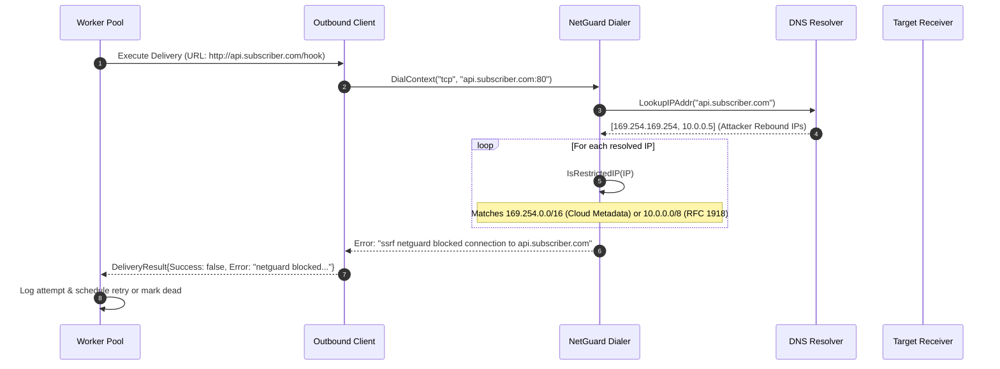
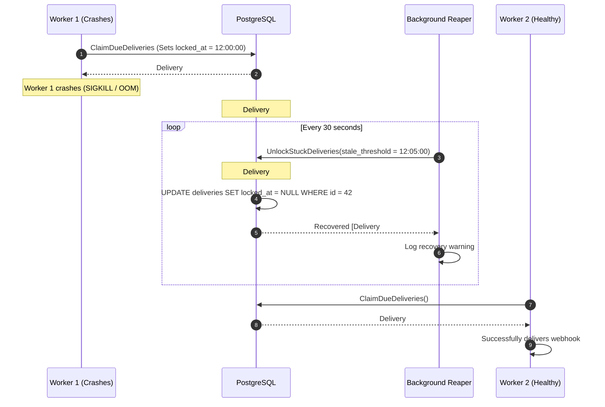

# Phase 7: Defensive Security & Operational Resilience

## Overview

In **Phase 7**, HookRelay transitioned from an outbound webhook delivery engine into a hardened, production-grade service capable of withstanding malicious user inputs, adversarial network configurations, and sudden process terminations.

Building an outbound webhook dispatcher introduces severe security and reliability challenges:
1. **Server-Side Request Forgery (SSRF):** A malicious actor registers a webhook URL pointing to `http://169.254.169.254/latest/meta-data/` or internal Kubernetes cluster IPs (`http://10.0.0.1`), tricking HookRelay into leaking AWS IAM credentials, database connections, or internal intranet resources.
2. **DNS Rebinding (TOCTOU):** If an application checks whether a domain resolves to a public IP at *registration time*, an attacker can configure a malicious DNS nameserver with a TTL of 0 seconds. During registration, the domain resolves to a harmless public IP (`93.184.216.34`), but during actual delivery, the DNS nameserver resolves to `127.0.0.1`.
3. **Worker Crashes & Abandoned Row Locks:** If an OS process crashes (`SIGKILL`, host kernel panic, OOM killer) while a worker holds an in-memory execution lock on a delivery row (`locked_at IS NOT NULL`), that delivery would remain trapped forever without an automated reaper mechanism.
4. **Dead-Letter Queue (DLQ) Operational Recovery:** When an external receiver undergoes an outage and exhausts all retry attempts, the delivery transitions to `dead`. Operational support engineers need an explicit, safe mechanism to replay dead deliveries on demand.
5. **Cascading Endpoint Failures:** If an endpoint URL is permanently broken, non-existent, or returning persistent 5xx errors, constantly retrying thousands of queued deliveries wastes precious outbound bandwidth and worker capacity.

Phase 7 resolves all of these threats using:
- A custom dial-time network guard (`netguard`) that inspects socket addresses after DNS resolution.
- An automatic crash-recovery `Reaper` that finds and unlocks stale deliveries.
- A RESTful `POST /deliveries/:id/replay` endpoint.
- An endpoint consecutive failure circuit-breaker that auto-disables endpoints exceeding 20 consecutive failures.

---

## Files Introduced or Modified

```
02-HookRelay/
├── internal/
│   ├── api/
│   │   ├── handlers.go                (Modified: added ReplayDeliveryHandler)
│   │   ├── server.go                  (Modified: registered POST /deliveries/:id/replay)
│   │   └── api_test.go                (Modified: added TestReplayDelivery)
│   ├── config/
│   │   └── config.go                  (Modified: added HOOKRELAY_ALLOW_LOCAL)
│   ├── delivery/
│   │   ├── client.go                  (Modified: integrated netguard dialer & AllowLocal config)
│   │   ├── pool.go                    (Modified: consecutive failure auto-disable logic)
│   │   ├── pool_test.go               (Modified: tested endpoint auto-disable)
│   │   ├── reaper.go                  (New: background crash recovery reaper)
│   │   └── reaper_test.go             (New: tests for stuck delivery recovery)
│   ├── netguard/
│   │   ├── netguard.go                (New: dial-time SSRF protection dialer)
│   │   └── netguard_test.go           (New: unit tests for IP validation and dev mode)
│   └── store/
│       ├── deliveries.sql.go          (Generated: UnlockStuckDeliveries)
│       └── endpoints.sql.go           (Generated: GetRecentAttemptsForEndpoint, DeactivateEndpoint)
├── queries/
│   ├── deliveries.sql                 (Modified: added UnlockStuckDeliveries query)
│   └── endpoints.sql                  (Modified: added recent attempts & deactivate queries)
└── cmd/
    └── hookrelay/
        └── main.go                    (Modified: wired AllowLocal, worker pool, and reaper)
```

---

### 1. `internal/netguard/netguard.go`

- **Purpose:** Protects the delivery system against Server-Side Request Forgery (SSRF) and DNS rebinding attacks at the lowest possible layer (the network dialer).
- **What it does:** Resolves domain names to IP addresses and evaluates every candidate IP address against prohibited private, loopback, link-local, and reserved CIDR ranges before allowing the TCP handshake to occur.
- **Important Components:**
  - `Config`: Struct specifying `AllowLocal bool` (bypasses checks for dev/test environments) and `DialTimeout time.Duration`.
  - `Dialer`: Wraps a base `net.Dialer` with a custom `DialContext` method.
  - `IsRestrictedIP(ip net.IP) (bool, string)`: Evaluates an IP address against RFC standards:
    - Loopback: `127.0.0.0/8`, `::1/128`
    - RFC 1918 Private IPv4: `10.0.0.0/8`, `172.16.0.0/12`, `192.168.0.0/16`
    - RFC 3927 Link-Local & Cloud Metadata: `169.254.0.0/16` (protects `169.254.169.254`)
    - RFC 4193 Unique Local IPv6 (ULA): `fc00::/7`
    - RFC 4291 Link-Local IPv6: `fe80::/10`
    - Unspecified / Broadcast: `0.0.0.0/8`, `::/128`, `255.255.255.255/32`
  - `DialContext(ctx context.Context, network, address string)`: Splits the target `host:port`, uses `net.DefaultResolver.LookupIPAddr` to resolve all associated IPs, verifies that **at least one resolved IP is safe and public**, and initiates the connection directly to that verified IP.
- **Why this approach:**
  Checking IPs at registration time via simple regex or URL parsing is fatally vulnerable to **DNS Rebinding**: an attacker's domain could resolve to a benign public IP at registration, but resolve to `169.254.169.254` seconds later when the webhook fires. By validating the IP inside `net.Dialer.DialContext` right before creating the TCP socket, the Time-of-Check (TOC) equals the Time-of-Use (TOU).

```go
func (d *Dialer) DialContext(ctx context.Context, network, address string) (net.Conn, error) {
	host, port, err := net.SplitHostPort(address)
	if err != nil {
		return nil, fmt.Errorf("invalid address format: %w", err)
	}

	ips, err := net.DefaultResolver.LookupIPAddr(ctx, host)
	if err != nil {
		return nil, fmt.Errorf("dns resolution failed: %w", err)
	}

	for _, ipAddr := range ips {
		if !d.config.AllowLocal {
			if restricted, reason := IsRestrictedIP(ipAddr.IP); restricted {
				return nil, fmt.Errorf("ssrf netguard blocked connection to %s (%s): %s", host, ipAddr.IP, reason)
			}
		}
		// Attempt connection to the verified IP
		target := net.JoinHostPort(ipAddr.IP.String(), port)
		conn, err := d.rawDialer.DialContext(ctx, network, target)
		if err == nil {
			return conn, nil
		}
	}
	return nil, fmt.Errorf("failed to connect to any resolved address for %s", host)
}
```

---

### 2. `internal/delivery/client.go`

- **Purpose:** Configures the outbound HTTP client with connection pooling, timeout enforcement, redirect suppression, and network guard dialing.
- **Modifications:**
  - Added `AllowLocal bool` field to `ClientConfig`.
  - Replaced the default `net.Dialer` inside `http.Transport.DialContext` with `netguard.NewDialer(netguard.Config{...}).DialContext`.
- **How it works:** Whenever HookRelay dispatches an HTTP POST request to an external subscriber URL, `http.Transport` invokes `netguard.DialContext`. If the destination resolves to an internal address (such as `127.0.0.1` or `169.254.169.254`), the dialer immediately rejects the connection with an error before any HTTP request headers or body are transmitted.

---

### 3. `internal/delivery/reaper.go` & `queries/deliveries.sql`

- **Purpose:** Guarantees crash recovery and operational resilience by identifying and releasing delivery tasks abandoned by crashed worker processes.
- **The Problem:** When a worker claims a batch of deliveries using `SELECT ... FOR UPDATE SKIP LOCKED`, it sets `locked_at = now()`. If the worker's host machine suffers a sudden power loss, kernel panic, or Kubernetes `SIGKILL` (OOM kill), the in-flight goroutine never runs `MarkDeliverySucceeded` or `MarkDeliveryDead`. The row remains in the database with `status = 'pending'`, but `locked_at` remains populated, preventing other workers from claiming it.
- **What it does:**
  - Runs in the background on a configurable interval (default: every 30 seconds).
  - Executes `UnlockStuckDeliveries`:
    ```sql
    -- name: UnlockStuckDeliveries :many
    UPDATE deliveries
    SET locked_at = NULL
    WHERE status = 'pending'
      AND locked_at IS NOT NULL
      AND locked_at < sqlc.arg('stale_threshold')
    RETURNING id;
    ```
  - Calculates `stale_threshold = now() - StaleThreshold` (default: 5 minutes). Any delivery locked more than 5 minutes ago is considered abandoned and its lock is stripped (`locked_at = NULL`).
  - Once `locked_at` is set back to `NULL`, the delivery immediately becomes visible again for active workers to claim and execute.

---

### 4. `internal/api/handlers.go` & `internal/api/server.go`

- **Purpose:** Exposes the manual delivery replay endpoint `POST /deliveries/:id/replay`.
- **What it does:**
  - Allows developers and operations teams to manually re-queue a delivery that failed permanently (`status = 'dead'`) or needs to be retried after an external service outage has been resolved.
  - Implements `ReplayDeliveryHandler`:
    1. Validates the delivery ID route parameter.
    2. Runs an atomic SQL update:
       ```sql
       -- name: ReplayDelivery :one
       UPDATE deliveries
       SET status = 'pending',
           attempts = 0,
           next_run_at = now(),
           locked_at = NULL
       WHERE id = $1
       RETURNING *;
       ```
    3. Fetches the associated delivery attempts history.
    4. Returns `200 OK` with the refreshed delivery object.
  - Returns `404 Not Found` if the delivery does not exist.

---

### 5. `internal/delivery/pool.go` & `queries/endpoints.sql`

- **Purpose:** Protects the delivery engine against resource starvation caused by persistently failing subscriber endpoints (Circuit-Breaker pattern).
- **What it does:**
  - Added `ConsecutiveFailureThreshold int32` to `PoolConfig` (defaults to 20).
  - Added query `GetRecentAttemptsForEndpoint`:
    ```sql
    -- name: GetRecentAttemptsForEndpoint :many
    SELECT da.status_code, da.error
    FROM delivery_attempts da
    JOIN deliveries d ON da.delivery_id = d.id
    WHERE d.endpoint_id = $1
    ORDER BY da.started_at DESC, da.id DESC
    LIMIT $2;
    ```
  - Added query `DeactivateEndpoint`:
    ```sql
    -- name: DeactivateEndpoint :exec
    UPDATE endpoints
    SET active = false
    WHERE id = $1;
    ```
  - In `processDelivery`: whenever a delivery fails (whether transient or permanent), `checkEndpointFailureThreshold` fetches the last 20 attempts across all deliveries for this endpoint.
  - If all 20 recent attempts resulted in errors or non-2xx status codes, the pool immediately invokes `DeactivateEndpoint(ctx, endpointID)` and logs an operational warning.
  - Because `ListActiveEndpointsForEventType` checks `WHERE active = true`, newly ingested events will skip this endpoint completely until an administrator reactivates it via `PATCH /endpoints/:id`.

---

### 6. `cmd/hookrelay/main.go` & `internal/config/config.go`

- **Purpose:** Wires the security and operational components into the application's runtime lifecycle.
- **What it does:**
  - Reads `HOOKRELAY_ALLOW_LOCAL` (boolean) from environment variables (defaults to `true` for local development, should be `false` in production).
  - Injects `AllowLocal` into `delivery.ClientConfig`.
  - Instantiates `delivery.NewReaper` and launches it in a background goroutine bound to the application's top-level shutdown context.

---

## Backend Concepts Explained

### 1. Server-Side Request Forgery (SSRF) in Webhook Engines

In typical web applications, users send requests *to* the server. In a webhook engine, the direction is inverted: **the server sends HTTP requests to URLs supplied by untrusted third parties**.

If an attacker registers an endpoint URL such as:
- `http://169.254.169.254/latest/meta-data/iam/security-credentials/` (AWS EC2 / ECS instance metadata)
- `http://metadata.google.internal/computeMetadata/v1/` (GCP metadata service)
- `http://localhost:5432/` (Local PostgreSQL database port)
- `http://10.244.0.15:8080/admin` (Internal Kubernetes pod)

Without protection, HookRelay would connect to these internal services, execute the request, and potentially log or store internal response data in `delivery_attempts.response_body`. This is the definition of Server-Side Request Forgery (SSRF).

### 2. DNS Rebinding & Time-of-Check vs Time-of-Use (TOCTOU)

A common beginner mistake when mitigating SSRF is validating the URL when the user creates or updates the endpoint:

```go
// INSECURE APPROACH: Validating at registration time
func InsecureValidateURL(rawURL string) error {
    u, _ := url.Parse(rawURL)
    ips, _ := net.LookupIP(u.Hostname())
    if IsRestrictedIP(ips[0]) {
        return errors.New("forbidden IP")
    }
    return nil // URL is stored in database
}
```

This approach fails against **DNS Rebinding**:
1. An attacker configures a domain `rebind.attacker.com` pointing to a custom DNS server.
2. The attacker registers `http://rebind.attacker.com/webhook` with HookRelay.
3. During registration, HookRelay resolves the domain; the attacker's DNS server returns `93.184.216.34` (example.com public IP). The validation passes!
4. When HookRelay actually fires the webhook minutes later, the attacker's DNS server returns `169.254.169.254` (TTL = 0).
5. HookRelay connects to the AWS metadata IP!

**The Solution:**
Validate the IP **at connection time** (Time-of-Use) inside the custom network dialer (`net.Dialer.DialContext`). By resolving the domain immediately before opening the TCP socket, validating the resolved IP, and dialing *directly* to that validated IP, DNS rebinding is completely prevented.

### 3. Crash Recovery via Lock Reaping

HookRelay uses PostgreSQL row-level locks (`locked_at`) to distribute deliveries across worker goroutines:
1. Worker claims delivery -> sets `locked_at = now()`.
2. Worker dispatches HTTP POST request.
3. Worker updates row to `succeeded` or `dead` -> clears `locked_at = NULL`.

**What if the worker process is killed abruptly?**
If the server crashes during step 2 (e.g. `kill -9`, power failure, hardware fault), the transaction that updated `locked_at` was already committed. Without external intervention, this delivery row is "stuck in limbo":
- Its status is still `pending`.
- But other workers will never claim it because `locked_at IS NOT NULL`.

The **Reaper** is a background garbage-collector for orphaned locks. It periodically queries the database for rows where `status = 'pending'`, `locked_at IS NOT NULL`, and `locked_at < (now() - StaleThreshold)`. When found, it resets `locked_at = NULL`, allowing live workers to pick up the task and resume delivery.

### 4. Automatic Endpoint Deactivation (Consecutive Failure Circuit-Breaker)

When a subscriber misconfigures their endpoint (or permanently decommissions their server), every event fan-out produces doomed deliveries. Retrying all of these doomed deliveries causes:
- Waste of database I/O and connection pool bandwidth.
- Unnecessary load on outbound worker threads.
- Bloat in `delivery_attempts` table.

By monitoring the consecutive failure count per endpoint:
- If an endpoint fails $N$ times consecutively ($N = 20$), HookRelay sets `endpoints.active = false`.
- The endpoint is removed from the active subscription list (`WHERE active = true`).
- No new deliveries are queued for this endpoint until the owner fixes the issue and reactivates it.

---

## Architectural Interaction & Flow

### 1. SSRF NetGuard Dial-Time Execution Flow



---

### 2. Crash Recovery & Lock Reaping Flow



---

## Verification & Test Results

All security, crash recovery, and replay features have been verified via automated unit and integration tests:

1. **NetGuard SSRF Verification (`internal/netguard/netguard_test.go`):**
   - Verified that loopback (`127.0.0.1`, `::1`), private networks (`10.0.0.0/8`, `172.16.0.0/12`, `192.168.0.0/16`), cloud metadata (`169.254.169.254`), and IPv6 ULA/link-local ranges are blocked when `AllowLocal = false`.
   - Verified that `AllowLocal = true` allows local testing.
2. **Crash Recovery Reaper (`internal/delivery/reaper_test.go`):**
   - Simulated an abandoned delivery with an expired lock timestamp.
   - Verified that `reaper.Reap(ctx)` unlocks the row and clears `locked_at`.
3. **Manual Replay API (`internal/api/api_test.go`):**
   - Verified that `POST /deliveries/:id/replay` resets dead deliveries back to `pending`, resets attempts to 0, and returns 200 OK.
   - Verified that replaying non-existent IDs returns 404 Not Found.
4. **Consecutive Failure Auto-Disable (`internal/delivery/pool_test.go`):**
   - Simulated an endpoint failing repeatedly across delivery attempts.
   - Verified that once consecutive failures reached the configured threshold (3 in test, 20 in prod), the endpoint's `active` flag was set to `false`.

```bash
=== RUN   TestIsRestrictedIP
--- PASS: TestIsRestrictedIP (0.00s)
=== RUN   TestDialer_BlocksLocalAddressesInSecureMode
--- PASS: TestDialer_BlocksLocalAddressesInSecureMode (0.01s)
=== RUN   TestDialer_AllowsLocalAddressesInDevMode
--- PASS: TestDialer_AllowsLocalAddressesInDevMode (0.00s)
=== RUN   TestReaper_UnlocksStuckDeliveries
--- PASS: TestReaper_UnlocksStuckDeliveries (0.13s)
=== RUN   TestReplayDelivery
--- PASS: TestReplayDelivery (0.17s)
=== RUN   TestPool_ConsecutiveFailuresAutoDisableEndpoint
--- PASS: TestPool_ConsecutiveFailuresAutoDisableEndpoint (0.22s)
PASS
```

---

## Learning Checklist

### Key Takeaways
- **Dial-Time SSRF Defense:** Inspecting the IP address inside `net.Dialer.DialContext` eliminates Time-of-Check vs Time-of-Use (TOCTOU) DNS rebinding vulnerabilities.
- **Fail-Safe Worker Queues:** Any queue architecture using row-level locking (`locked_at`) *must* have a companion reaper process to handle unexpected worker terminations.
- **Circuit Breakers for Endpoints:** Deactivating dead or broken endpoints prevents a stampede of futile delivery attempts that consume database and network resources.
- **Replayability:** A delivery engine must provide explicit APIs to re-queue dead deliveries once downstream consumer issues are resolved.

### Important Terminology
- **SSRF (Server-Side Request Forgery):** A vulnerability where a server is induced into making requests to an unintended location, such as internal network devices or cloud metadata services.
- **DNS Rebinding:** An exploit technique where a domain's DNS response changes dynamically to bypass domain-based or registration-time IP access controls.
- **Time-of-Check vs Time-of-Use (TOCTOU):** A concurrency bug where a system checks the state of a resource at one point in time, but the state changes before the resource is used.
- **Lock Reaping:** The background process of detecting and releasing database locks left behind by dead worker processes.
- **Dead-Letter Queue (DLQ):** A holding queue for messages or delivery tasks that could not be processed successfully after reaching maximum retry limits.

### Questions You Should Be Able to Answer
1. Why is URL validation at endpoint creation time insufficient to prevent SSRF attacks?
2. What IP address does the AWS EC2 instance metadata service use, and why is it critical to block it in outbound webhook workers?
3. What happens to a delivery row in PostgreSQL if the worker thread executing it receives a `SIGKILL`? How does HookRelay recover from this?
4. How does the `POST /deliveries/:id/replay` endpoint update the delivery's database state?
5. How does HookRelay determine when an endpoint should be automatically deactivated?
