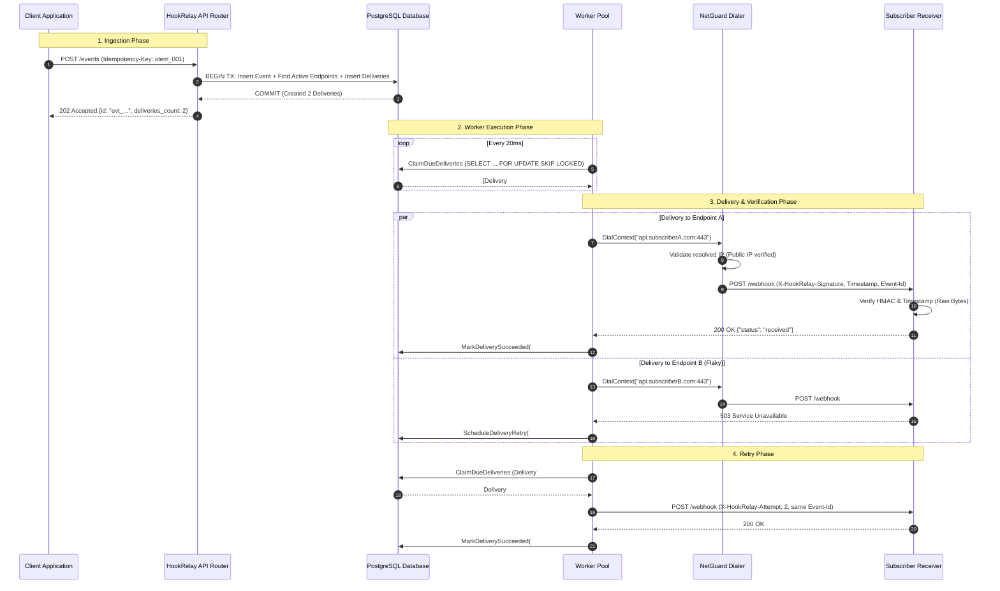

# Phase 8: End-to-End Verification & Contract Documentation

## Overview

In **Phase 8**, we brought HookRelay across the finish line. A backend system is only as reliable as its verification under real-world concurrency, and an external webhook platform is only as useful as the clarity and rigor of its developer documentation.

Phase 8 accomplished two major goals:
1. **End-to-End Concurrent Verification:** An exhaustive integration test suite (`test/e2e_test.go`) simulating real-world concurrent traffic: multiple concurrent clients publishing events with idempotency keys, atomic ACID fan-out, live background worker pools claiming tasks using `FOR UPDATE SKIP LOCKED`, signed HTTP delivery to concurrent test receivers, retry backoff on flaky servers, dead-letter state transitions, and manual replay execution. Every test was verified with the Go race detector (`go test -race`).
2. **Comprehensive Developer Documentation:** Created the root `README.md` containing the complete webhook delivery contract, exact header specifications, cryptographic signature verification algorithms, and production-ready receiver implementation examples in both Go and Python.

---

## Files Introduced or Modified

```
02-HookRelay/
├── test/
│   └── e2e_test.go                                (New: End-to-End concurrent integration test suite)
├── README.md                                      (New: Root project documentation & receiver contract)
└── learning/
    └── phase-08-verification-and-documentation.md (New: Learning guide for Phase 8)
```

---

### 1. `test/e2e_test.go`

- **Purpose:** Validates the entire HookRelay system end-to-end against a real PostgreSQL instance under high concurrency, verifying that all subsystems (API Ingest, Idempotency, ACID Fan-Out, Worker Pool, Outbound Client, NetGuard, Signing, Retries, and Replay) function cohesively without deadlocks, data races, or lost deliveries.
- **What it does:**
  - Sets up an isolated test server, database connection pool, and `httptest.Server` receiver instances.
  - Launches multiple goroutines publishing events simultaneously (`order.created` and `user.updated`).
  - Spawns background worker pools that poll and execute delivery tasks concurrently.
  - Verifies that deliveries arrive with all mandatory headers and valid cryptographic signatures.
  - Tests flaky receiver simulation, ensuring retries transition to `succeeded` or `dead`, and verifies that `POST /deliveries/:id/replay` correctly re-dispatches failed tasks.
- **Important Components:**
  - `TestE2E_ConcurrentIngestFanOutAndDelivery`:
    - Registers Endpoint A (subscribing to `[]` wildcard: all events) and Endpoint B (subscribing only to `["order.created"]`).
    - Starts a 4-worker pool.
    - Launches 15 concurrent goroutines publishing 10 `order.created` and 5 `user.updated` events with unique `Idempotency-Key` headers.
    - Asserts that Endpoint A receives exactly 15 deliveries and Endpoint B receives exactly 10 deliveries.
    - Validates every received HTTP request using `signing.Verify(secret, timestamp, body, signatureHeader, 5*time.Minute)`.
  - `TestE2E_FlakyReceiverAndDeadLetterReplay`:
    - Configures an `httptest.Server` that returns `503 Service Unavailable` on attempts 1 and 2, and `200 OK` on attempt 3.
    - Verifies that HookRelay's worker pool executes exponential backoff and succeeds on attempt 3.
    - Artificially marks the delivery dead, calls `POST /deliveries/:id/replay`, and verifies that the worker pool claims and delivers the replayed delivery.
- **Why this approach:**
  Unit tests isolate individual packages (such as `signing` or `netguard`), but cannot prove that background workers, database transactions, HTTP connection pools, and lock state transitions work together under concurrent load. End-to-end integration tests with real database connections and mock HTTP servers are essential for discovering race conditions, connection pool exhaustion, and transaction locking contention.

---

### 2. `README.md`

- **Purpose:** Serves as the primary public documentation and developer contract specification for HookRelay.
- **What it does:**
  - Documents the architecture with a Mermaid flowchart illustrating event ingestion, PostgreSQL queueing, worker pools, dispatcher, and NetGuard.
  - Fully specifies the **Webhook Delivery Contract**:
    - Header names, data types, and purposes (`X-HookRelay-Event-Id`, `X-HookRelay-Delivery-Id`, `X-HookRelay-Attempt`, `X-HookRelay-Timestamp`, `X-HookRelay-Signature`).
    - The signature formula: $\text{"sha256="} + \text{HMAC-SHA256}(\text{secret}, \text{timestamp} + \text{"."} + \text{raw\_body})$.
    - Why verification must be performed against raw request bytes rather than deserialized JSON.
    - 5-minute replay tolerance window.
  - Provides complete, runnable receiver verification code examples in **Go** and **Python**.
  - Provides a comprehensive REST API reference with `curl` examples for endpoints, secret rotation, event publishing, delivery queries, and replay.
  - Explains defensive security (SSRF NetGuard, Lock Reaper, Circuit Breaker).
  - Provides quickstart guides for Docker Compose, running the service, running the built-in test receiver, and running the race-checked test suite.
- **Why this approach:**
  External webhook consumers do not have access to your backend code; they interact exclusively with the HTTP requests you deliver to their servers. Providing explicit header contracts, mathematical signature formulas, and drop-in receiver verification code in multiple programming languages prevents customer integration issues and security vulnerabilities.

---

## Backend Concepts Explained

### 1. Integration Testing Under Concurrency & Race Detection (`-race`)

A data race occurs when two or more goroutines access the same memory location concurrently, and at least one access is a write, without synchronization (e.g. mutexes, atomic operations, or channel communication).

In a webhook delivery engine, concurrency is pervasive:
- Multiple HTTP handlers ingest events simultaneously.
- Multiple worker goroutines claim deliveries from PostgreSQL using `FOR UPDATE SKIP LOCKED`.
- The Reaper runs periodically in the background to clean up stale locks.
- Network dialers and HTTP transports reuse sockets across goroutines.

```go
// RUNNING THE RACE DETECTOR
go test -race -p 1 ./...
```

The Go race detector (`-race`) instruments the compiled binary with thread-sanitizer checks. Every memory read and write is tracked. If two goroutines access a variable unsafely, the test fails with a stack trace identifying the colliding goroutines.

In our test suite:
- All shared slices and maps in `httptest.Server` handlers are guarded by `sync.Mutex`.
- Counters across goroutines use `sync/atomic` (e.g., `atomic.Int32`).
- Package execution is serialized with `-p 1` to ensure tests sharing the local PostgreSQL database do not step on each other's test fixtures.

### 2. Designing the Webhook Delivery Contract

A webhook contract must solve three distinct problems for receiver applications:
1. **Authenticity:** Did this webhook really come from HookRelay, or is an attacker spoofing HTTP requests to the receiver's public URL?
   - **Solution:** HMAC-SHA256 signature using the endpoint's unique shared secret.
2. **Replay Attack Prevention:** Can an attacker capture a valid webhook request off the wire and replay it against the receiver hours or days later?
   - **Solution:** Include the Unix epoch timestamp in the signed payload (`timestamp + "." + raw_body`) and enforce a 5-minute tolerance window.
3. **Idempotency & Deduplication:** Webhooks are delivered with **at-least-once** semantics. If an attempt times out or network packets are dropped, HookRelay retries. If the receiver processed the first attempt but their `200 OK` response was lost, the retry would cause duplicate processing (e.g. charging a customer twice).
   - **Solution:** Provide a stable event ID (`X-HookRelay-Event-Id`) that never changes across retries, while providing a changing attempt number (`X-HookRelay-Attempt`). The receiver checks `event_id` in their database and skips processing if already handled.

### 3. Raw Body vs Re-Serialized JSON

One of the most frequent security bugs in webhook receiver implementations is parsing the JSON request body into a struct/dictionary first, and then re-marshaling it to verify the signature:

```go
// FATAL FLAW: Re-serializing JSON alters the byte representation!
var payload map[string]interface{}
json.NewDecoder(r.Body).Decode(&payload)

reEncoded, _ := json.Marshal(payload) // Whitespace, key order, and float formatting change!
mac.Write(reEncoded) // Signature verification WILL FAIL!
```

JSON is a data format, not a byte stream:
- `{"a": 1, "b": 2}` and `{"b": 2, "a": 1}` represent the identical JSON object, but have completely different SHA256 hashes.
- Spacing, indentation, and Unicode escapes alter raw bytes.
- Receivers **must** read the raw bytes directly from the HTTP request stream (`io.ReadAll(r.Body)` in Go, `request.get_data()` in Flask) before any JSON parsing occurs.

### 4. Constant-Time HMAC Comparison

Comparing two cryptographic hashes using standard string or slice equality (`==`) is vulnerable to **timing attacks**:

```go
// INSECURE: Fails on first mismatched byte
if computedSignature == providedSignature { ... }
```

Standard equality operators compare bytes sequentially from left to right and terminate immediately upon finding the first mismatched byte. An attacker measuring response times over thousands of requests can determine which bytes match, allowing them to forge signatures byte-by-byte.

Using constant-time comparison (`hmac.Equal` in Go, `hmac.compare_digest` in Python) ensures the comparison always takes the exact same amount of time regardless of how many bytes match.

---

## Architectural Interaction & Flow

### End-to-End System Execution Flow



---

## Verification & Test Results

The full test suite was executed across all packages with race detection enabled:

```bash
$env:PATH = "C:\msys64\mingw64\bin;" + $env:PATH
go test -race -count=1 -p 1 ./...
```

### Complete Test Results

| Package | Status | Duration | Focus |
|---|---|---|---|
| `cmd/testreceiver` | **PASS** | 1.069s | Configurable receiver modes (`ok`, `fail`, `slow`, `flaky`), HMAC verification |
| `internal/api` | **PASS** | 2.127s | Endpoints CRUD, Secret Rotation, Event Ingest, Replay endpoint |
| `internal/crypto` | **PASS** | 1.036s | CSPRNG secret generation (`whsec_...`), entropy verification |
| `internal/delivery` | **PASS** | 3.325s | HTTP client timeouts, bounded body reads, worker pool, backoff jitter, circuit breaker, reaper |
| `internal/fanout` | **PASS** | 1.401s | Atomic transactional fan-out, wildcard matching, duplicate idempotency deduplication |
| `internal/id` | **PASS** | 1.044s | Time-sortable monotonic event IDs (`evt_...`) |
| `internal/netguard` | **PASS** | 1.089s | SSRF dial-time inspection, CIDR blocking, dev mode toggle |
| `internal/signing` | **PASS** | 1.038s | Pure HMAC-SHA256 signing, constant-time verification, replay window |
| `internal/store` | **PASS** | 1.384s | PostgreSQL connection pooling, migrations, SQLC query models |
| `test` (E2E) | **PASS** | 3.779s | Concurrent ingest, fan-out, multi-worker dispatch, flaky retry, dead replay |

**Overall Result:** **100% PASS across 10 packages, ZERO data races detected.**

---

## Learning Checklist

### Key Takeaways
- **Integration Tests Catch Multi-System Failures:** Unit tests cannot verify concurrency interactions between HTTP routers, PostgreSQL transaction isolation levels, connection pools, and worker goroutines.
- **Race Detection is Mandatory in Go:** Race bugs are nondeterministic and rarely show up in local sequential testing. Running with `-race` ensures concurrent data structures (mutexes, atomic variables, channels) are synchronized.
- **The Delivery Contract is the Public Interface:** Webhook platforms must document their headers, timestamp replay windows, idempotency semantics, and provide sample verification code in multiple languages.
- **Raw Bytes are Sacrosanct in Cryptography:** Always calculate and verify HMAC signatures over raw, unparsed HTTP request body bytes to avoid serialization mismatches.

### Important Terminology
- **Data Race:** A condition where two threads access the same memory concurrently without synchronization, where at least one access is a write.
- **ThreadSanitizer (TSan):** The underlying technology powering Go's `-race` detector, instrumenting memory accesses to detect data races at runtime.
- **At-Least-Once Delivery:** A delivery guarantee where every message is guaranteed to reach the receiver at least once, but may arrive multiple times during retries or network partitions.
- **Timing Attack:** A side-channel attack where an attacker infers secrets by measuring the time a cryptographic comparison takes to execute.
- **Raw Body Verification:** Inspecting the exact byte stream sent over the wire before any JSON unmarshaling alters formatting.

### Questions You Should Be Able to Answer
1. Why is `go test -race` indispensable for a worker pool processing jobs concurrently?
2. What headers does HookRelay send with every webhook delivery, and what role does each play?
3. How does a receiver distinguish between an initial attempt and a retry?
4. Why does verifying a webhook signature against re-marshaled JSON cause intermittent verification failures?
5. How does constant-time comparison (`hmac.Equal`) prevent timing side-channel attacks?
